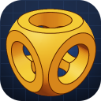
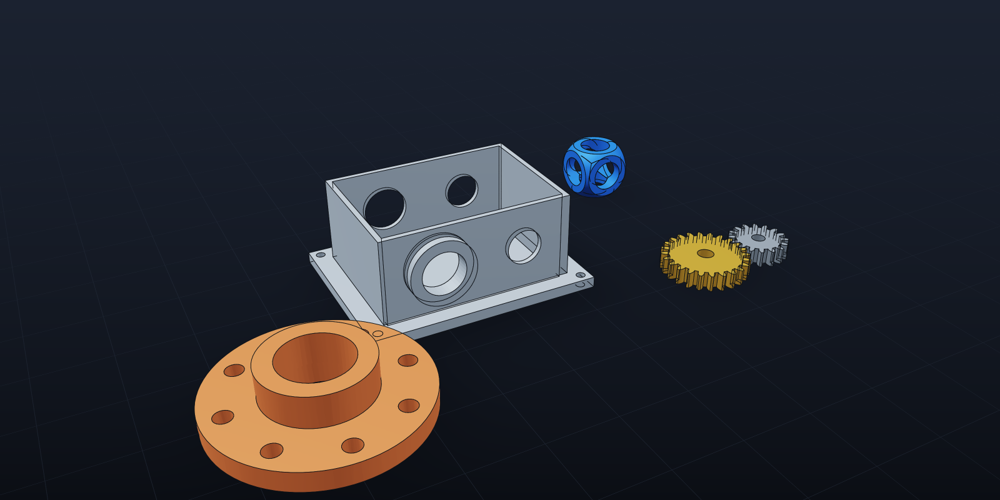
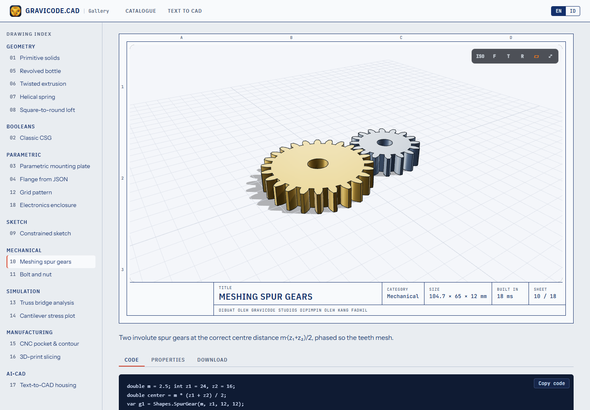
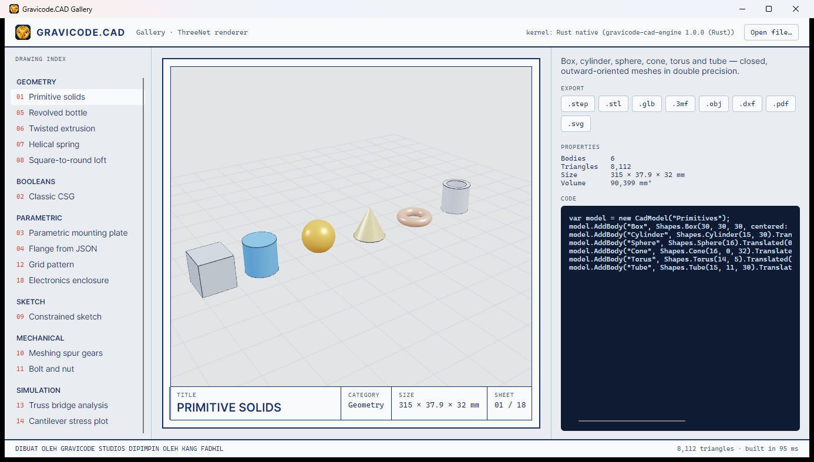
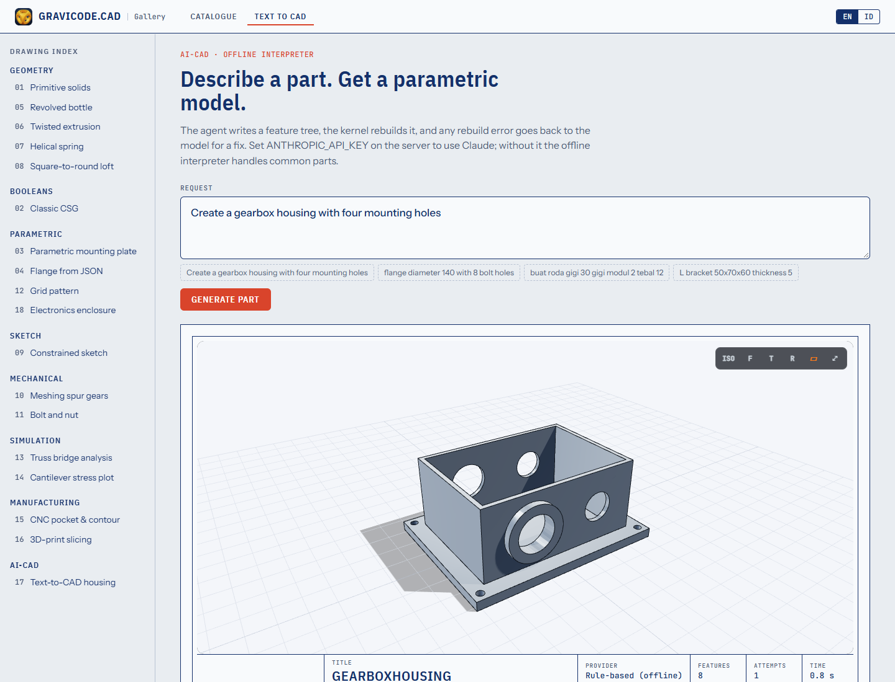

<p align="center"></p>

<h1 align="center">Gravicode.CAD</h1>

<p align="center"><b>Framework CAD, Geometri, Pemodelan Parametrik, Rendering, Simulasi, Interoperabilitas, dan AI-CAD kelas enterprise untuk .NET</b></p>

<p align="center">.NET 10 · C# 14 · Mesin native Rust · MIT<br/>
<i>Dibuat oleh Gravicode Studios dipimpin oleh Kang Fadhil</i></p>

<p align="center"><a href="README.md">🇬🇧 Read in English</a></p>



## Mengapa

Gravicode.CAD memberi developer .NET satu toolkit utuh untuk seluruh alur kerja CAD — memodelkan, memberi constraint, menganalisis, memanufaktur, bertukar file, dan merender — tanpa keluar dari C#. Berjalan di mana pun .NET 10 berjalan (server, desktop, mobile, browser lewat Blazor) dan memakai Rust untuk bagian yang paling berat.

```csharp
var model = Part.Create("Bracket")
    .Param("w", 120).Param("t", 10)
    .Box("w", 80, "t")
    .Holes(8.5, (-48, -28), (48, -28), (-48, 28), (48, 28))
    .Build();

model.Save("bracket.step");                 // STEP AP214
model.ExportStl("bracket.stl");             // STL biner
model.ExportPdf("bracket.pdf");             // gambar teknik 4 tampak
SoftwareRenderer.RenderToPng(model, "bracket.png");
```

```csharp
var model = StepImporter.Import("part.step");   // atau CadModel.Load("engine.step")
model.ExportStl("part.stl");
```

## Fitur

| Area | Isi |
|---|---|
| **Geometri** | `Vec2/Vec3/Mat4` presisi ganda, garis, busur, Bézier, NURBS rasional eksak, heliks; poligon dan offset; triangulasi ear-clipping dengan lubang; box/silinder/kerucut/bola/torus/pipa; extrude (dengan puntiran & draft), revolve, loft, sweep; roda gigi involute |
| **Boolean** | CSG berbasis pohon BSP (union / subtract / intersect) dengan perbaikan T-junction otomatis → hasil kedap (watertight) |
| **Topologi** | Struktur half-edge, cek watertight / manifold / orientasi, karakteristik Euler & genus, shell, loop batas, feature edge, rekonstruksi muka planar/lengkung (B-Rep-lite) |
| **Parametrik** | Parameter berbasis ekspresi (`"w/2 + 5"`), feature tree JSON (box, silinder, kerucut, bola, torus, pipa, extrude, revolve, loft, sweep, gear, hole + counterbore, pola linear/grid/melingkar, mirror), rebuild dengan log per fitur, builder `Part` bergaya CadQuery/Build123D |
| **Constraint** | Sketsa 2D dengan 16 jenis constraint, diselesaikan Levenberg–Marquardt; laporan derajat kebebasan; sketsa → profil → solid |
| **Interop** | STEP (baca B-Rep lanjut: bidang/silinder/kerucut, edge B-spline/lingkaran, warna; tulis AP214), IGES, STL, OBJ+MTL, glTF/GLB, 3MF, DXF (bulge, block, polyface), SVG, gambar PDF dengan hidden-line removal. DWG memberi panduan konversi |
| **Rendering** | Software renderer multi-thread tanpa dependensi → PNG; `<CadViewer>` three.js untuk Blazor; adapter ThreeNet (DirectX 12 / Metal / Vulkan) untuk desktop; viewport WPF & WinForms |
| **Simulasi** | FEM statik linear: rangka 2D/3D, plane-stress CST dengan von Mises, konduksi panas 2D, mesher Delaunay, solver PCG sparse, model hasil berwarna |
| **Manufaktur** | Kontur dengan kompensasi pahat, pocket zig-zag dengan pulau, peck drilling, slicer FDM (perimeter + infill), G-code GRBL / Marlin / LinuxCNC dengan estimasi waktu |
| **AI-CAD** | Teks → part parametrik tervalidasi dengan loop perbaikan mandiri. Claude (`claude-opus-5-5` lewat SDK resmi Anthropic), endpoint OpenAI-compatible (Azure OpenAI, DeepSeek, router Hugging Face) atau interpreter offline (Inggris + Bahasa Indonesia) |
| **Mesin native** | `gravicode-cad-engine` berbahasa Rust (C ABI): mass properties (multi-thread), normal, welding, slicing — diuji setara dengan kernel C#, otomatis kembali ke C# bila tidak tersedia |

## Paket

| Paket | Kegunaan |
|---|---|
| `Gravicode.CAD.Core` | Matematika, mesh, `CadModel`, registri format |
| `Gravicode.CAD.Geometry` | Kurva, triangulasi, primitif, sweep, CSG |
| `Gravicode.CAD.Topology` | Analisis half-edge, B-Rep-lite |
| `Gravicode.CAD.Parametric` | Parameter, feature tree, builder `Part` |
| `Gravicode.CAD.Constraint` | Solver sketsa 2D |
| `Gravicode.CAD.IO` | STEP, IGES, STL, OBJ, glTF, 3MF, DXF, SVG, PDF |
| `Gravicode.CAD.Native` | Binding mesin Rust |
| `Gravicode.CAD.Rendering` | Software renderer, kamera, logika view interaktif |
| `Gravicode.CAD.ThreeJs` | `<CadViewer>` Blazor (three.js) |
| `Gravicode.CAD.ThreeNet` | Rendering GPU desktop lewat ThreeNet |
| `Gravicode.CAD.Viewer.Wpf` / `.WinForms` | Kontrol viewport |
| `Gravicode.CAD.FEM` | Analisis elemen hingga |
| `Gravicode.CAD.CAM` | Toolpath, slicer, G-code |
| `Gravicode.CAD.AI` | Agen teks-ke-CAD |
| `gravicode-cad` | Tool baris perintah `gcad` |
| `Gravicode.CAD.Templates` | Template `dotnet new` |

## CLI

```bash
dotnet tool install -g gravicode-cad
gcad convert model.step model.stl
gcad info gear.step
gcad render bracket.step bracket.png --view iso
gcad drawing bracket.step bracket.pdf
gcad slice part.stl part.gcode --infill 0.2
gcad generate "buat housing gearbox dengan empat lubang mounting" -o out
```

## Template

```bash
dotnet new install Gravicode.CAD.Templates
dotnet new cad-console -n PartSaya     # juga: cad-webapi cad-blazor cad-wpf cad-winforms cad-avalonia cad-maui
```

## Galeri Gravicode.CAD

Delapan belas contoh yang bisa dijalankan — masing-masing menampilkan kode, properti, dan unduhan dalam sembilan format.

| Web (Blazor + three.js) | Desktop (Avalonia + ThreeNet) |
|---|---|
|  |  |

```bash
dotnet run --project gallery/Gravicode.CAD.Gallery.Web       # http://localhost:5180
dotnet run --project gallery/Gravicode.CAD.Gallery.Desktop
```



## Arsitektur

```text
Aplikasi ── WPF · WinForms · Blazor · ASP.NET Core · Console · MAUI · Avalonia
      │
SDK Gravicode.CAD ── Parametric · Constraint · FEM · CAM · AI · IO · Rendering
      │
API CAD tingkat tinggi ── Geometry (kurva, sweep, CSG) · Topology (half-edge, B-Rep-lite)
      │
Mesin native Rust ── gravicode-cad-engine (C ABI, IMeshKernel)
      │
Kernel CAD ── Core (matematika presisi ganda, mesh, CadModel)
```

Lihat [docs/id/Architecture.md](docs/id/Architecture.md).

## Dokumentasi

| Bahasa Indonesia | English |
|---|---|
| [Memulai](docs/id/GettingStarted.md) | [Getting started](docs/en/GettingStarted.md) |
| [Arsitektur](docs/id/Architecture.md) | [Architecture](docs/en/Architecture.md) |
| [Geometri](docs/id/Geometry.md) | [Geometry](docs/en/Geometry.md) |
| [Rendering](docs/id/Rendering.md) | [Rendering](docs/en/Rendering.md) |
| [ThreeNet](docs/id/ThreeNet.md) | [ThreeNet](docs/en/ThreeNet.md) |
| [Three.js](docs/id/ThreeJs.md) | [Three.js](docs/en/ThreeJs.md) |
| [AI](docs/id/AI.md) | [AI](docs/en/AI.md) |
| [CLI](docs/id/CLI.md) | [CLI](docs/en/CLI.md) |
| [Template](docs/id/Templates.md) | [Templates](docs/en/Templates.md) |

Roadmap: [PLAN.md](PLAN.md) · Status: [Progress.md](Progress.md)

## Membangun dari source

```bash
dotnet build Gravicode.CAD.slnx
dotnet test tests/Gravicode.CAD.Tests
./build-native.ps1              # opsional: build ulang mesin Rust (cargo)
```

## Kredit

Dibuat oleh **Gravicode Studios** dipimpin oleh **Kang Fadhil**. Dirilis dengan lisensi MIT.
