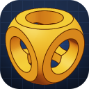
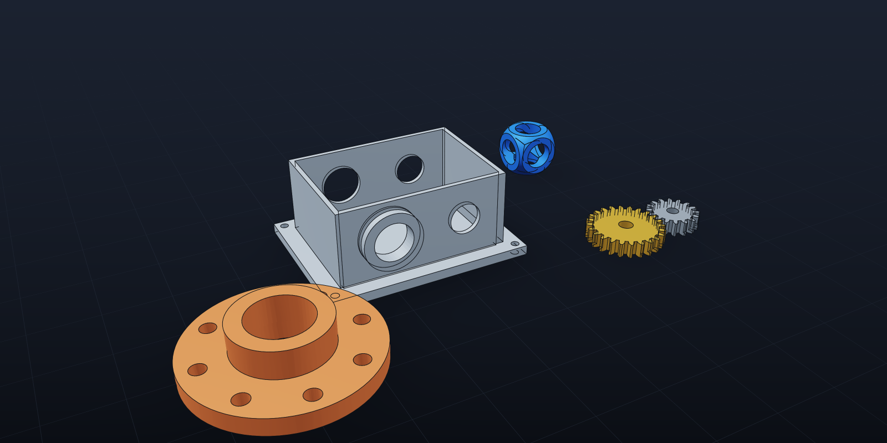
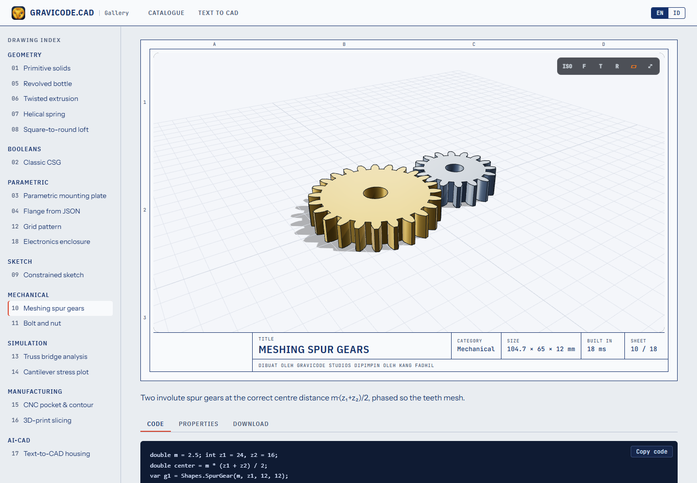
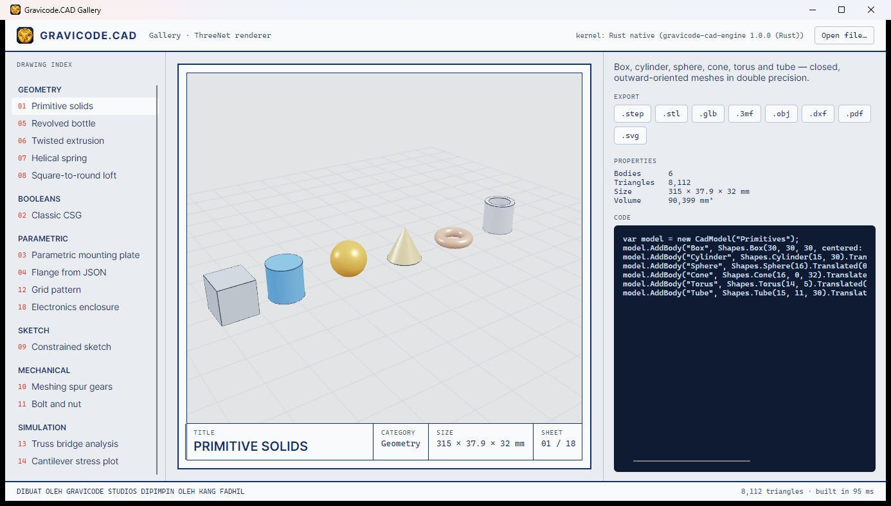
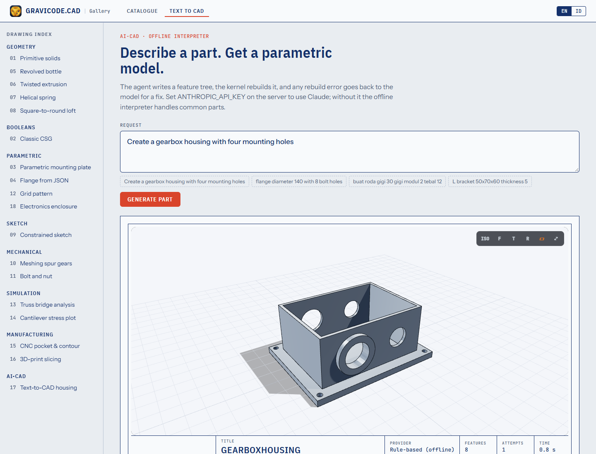

<p align="center"></p>

<h1 align="center">Gravicode.CAD</h1>

<p align="center"><b>Enterprise-grade CAD, Geometry, Parametric Modeling, Rendering, Simulation, Interoperability, and AI-CAD Framework for .NET</b></p>

<p align="center">.NET 10 · C# 14 · Rust native engine · MIT<br/>
<i>Made by Gravicode Studios, led by Kang Fadhil</i></p>

<p align="center"><a href="README.id.md">🇮🇩 Baca dalam Bahasa Indonesia</a></p>



## Why

Gravicode.CAD gives .NET developers one coherent toolkit for the whole CAD pipeline — model, constrain, analyse, manufacture, exchange and render — without leaving C#. It runs anywhere .NET 10 runs (servers, desktop, mobile, the browser through Blazor) and drops into Rust for the hot paths.

```csharp
var model = Part.Create("Bracket")
    .Param("w", 120).Param("t", 10)
    .Box("w", 80, "t")
    .Holes(8.5, (-48, -28), (48, -28), (-48, 28), (48, 28))
    .Build();

model.Save("bracket.step");                 // STEP AP214
model.ExportStl("bracket.stl");             // binary STL
model.ExportPdf("bracket.pdf");             // 4-view engineering drawing
SoftwareRenderer.RenderToPng(model, "bracket.png");
```

```csharp
var model = StepImporter.Import("part.step");   // or CadModel.Load("engine.step")
model.ExportStl("part.stl");
```

## Features

| Area | What you get |
|---|---|
| **Geometry** | Double-precision `Vec2/Vec3/Mat4`, lines, arcs, Bézier, exact rational NURBS, helices; polygons with offsets; ear-clipping triangulation with holes; box/cylinder/cone/sphere/torus/tube; extrude (with twist & draft), revolve, loft, sweep (rotation-minimising frames); involute spur gears |
| **Booleans** | BSP-tree CSG union / subtract / intersect with automatic T-junction repair → watertight results |
| **Topology** | Half-edge structure, watertight / manifold / orientation checks, Euler characteristic & genus, shells, boundary loops, feature edges, B-Rep-lite planar/curved face recovery |
| **Parametric** | Expression-driven parameters (`"w/2 + 5"`), JSON feature tree (box, cylinder, cone, sphere, torus, tube, extrude, revolve, loft, sweep, gear, hole + counterbore, linear/grid/circular pattern, mirror), rebuild with per-feature log, fluent CadQuery/Build123D-style `Part` builder |
| **Constraints** | 2D sketches with 16 constraint types solved by Levenberg–Marquardt; degrees-of-freedom report; sketch → profiles → solids |
| **Interop** | STEP (read advanced B-Rep with planes/cylinders/cones + B-spline/circle edges + colours; write AP214), IGES, STL, OBJ+MTL, glTF/GLB, 3MF, DXF (bulges, blocks, polyface), SVG, PDF drawings with hidden-line removal. DWG gives conversion guidance |
| **Rendering** | Dependency-free multi-threaded software renderer → PNG; three.js `<CadViewer>` for Blazor; ThreeNet (DirectX 12 / Metal / Vulkan) adapter for desktop; WPF & WinForms viewports |
| **Simulation** | Linear static FEM: 2D/3D trusses, plane-stress CST with von Mises, 2D heat conduction, Delaunay mesher, sparse PCG solver, colour-mapped result models |
| **Manufacturing** | Contour with tool compensation, zig-zag pocketing with islands, peck drilling, FDM slicer (perimeters + infill), G-code for GRBL / Marlin / LinuxCNC with time estimates |
| **AI-CAD** | Text → validated parametric part with a self-repair loop. Claude (`claude-opus-5-5` via the official Anthropic SDK), any OpenAI-compatible endpoint (Azure OpenAI, DeepSeek, Hugging Face router) or a fully offline interpreter (English + Bahasa Indonesia) |
| **Native engine** | Rust `gravicode-cad-engine` (C ABI): mass properties (multi-threaded), normals, welding, slicing — parity-tested with the C# kernels, automatic managed fallback |

## Packages

| Package | Purpose |
|---|---|
| `Gravicode.CAD.Core` | Math, meshes, `CadModel`, format registry |
| `Gravicode.CAD.Geometry` | Curves, triangulation, primitives, sweeps, CSG |
| `Gravicode.CAD.Topology` | Half-edge analysis, B-Rep-lite |
| `Gravicode.CAD.Parametric` | Parameters, feature tree, `Part` builder |
| `Gravicode.CAD.Constraint` | 2D sketch solver |
| `Gravicode.CAD.IO` | STEP, IGES, STL, OBJ, glTF, 3MF, DXF, SVG, PDF |
| `Gravicode.CAD.Native` | Rust engine bindings |
| `Gravicode.CAD.Rendering` | Software renderer, cameras, interactive view logic |
| `Gravicode.CAD.ThreeJs` | Blazor `<CadViewer>` (three.js) |
| `Gravicode.CAD.ThreeNet` | Desktop GPU rendering via ThreeNet |
| `Gravicode.CAD.Viewer.Wpf` / `.WinForms` | Viewport controls |
| `Gravicode.CAD.FEM` | Finite element analysis |
| `Gravicode.CAD.CAM` | Toolpaths, slicer, G-code |
| `Gravicode.CAD.AI` | Text-to-CAD agent |
| `gravicode-cad` | `gcad` command-line tool |
| `Gravicode.CAD.Templates` | `dotnet new` templates |

## CLI

```bash
dotnet tool install -g gravicode-cad
gcad convert model.step model.stl
gcad info gear.step
gcad render bracket.step bracket.png --view iso
gcad drawing bracket.step bracket.pdf
gcad slice part.stl part.gcode --infill 0.2
gcad generate "Create a gearbox housing with four mounting holes" -o out
```

## Templates

```bash
dotnet new install Gravicode.CAD.Templates
dotnet new cad-console -n MyPart      # also: cad-webapi cad-blazor cad-wpf cad-winforms cad-avalonia cad-maui
```

## Gravicode.CAD Gallery

Eighteen runnable samples — every one shows its code, its properties and downloads in nine formats.

| Web (Blazor + three.js) | Desktop (Avalonia + ThreeNet) |
|---|---|
|  |  |

```bash
dotnet run --project gallery/Gravicode.CAD.Gallery.Web       # http://localhost:5180
dotnet run --project gallery/Gravicode.CAD.Gallery.Desktop
```



## Architecture

```text
Applications ── WPF · WinForms · Blazor · ASP.NET Core · Console · MAUI · Avalonia
      │
Gravicode.CAD SDK ── Parametric · Constraint · FEM · CAM · AI · IO · Rendering
      │
High-level CAD API ── Geometry (curves, sweeps, CSG) · Topology (half-edge, B-Rep-lite)
      │
Rust native engine ── gravicode-cad-engine (C ABI, IMeshKernel)
      │
CAD kernel ── Core (double-precision math, meshes, CadModel)
```

See [docs/en/Architecture.md](docs/en/Architecture.md).

## Documentation

| English | Bahasa Indonesia |
|---|---|
| [Getting started](docs/en/GettingStarted.md) | [Memulai](docs/id/GettingStarted.md) |
| [Architecture](docs/en/Architecture.md) | [Arsitektur](docs/id/Architecture.md) |
| [Geometry](docs/en/Geometry.md) | [Geometri](docs/id/Geometry.md) |
| [Rendering](docs/en/Rendering.md) | [Rendering](docs/id/Rendering.md) |
| [ThreeNet](docs/en/ThreeNet.md) | [ThreeNet](docs/id/ThreeNet.md) |
| [Three.js](docs/en/ThreeJs.md) | [Three.js](docs/id/ThreeJs.md) |
| [AI](docs/en/AI.md) | [AI](docs/id/AI.md) |
| [CLI](docs/en/CLI.md) | [CLI](docs/id/CLI.md) |
| [Templates](docs/en/Templates.md) | [Template](docs/id/Templates.md) |

Roadmap: [PLAN.md](PLAN.md) · Status: [Progress.md](Progress.md)

## Building from source

```bash
dotnet build Gravicode.CAD.slnx
dotnet test tests/Gravicode.CAD.Tests
./build-native.ps1              # optional: rebuild the Rust engine (cargo)
```

## Credits

Made by **Gravicode Studios**, led by **Kang Fadhil**. Released under the MIT licence.
