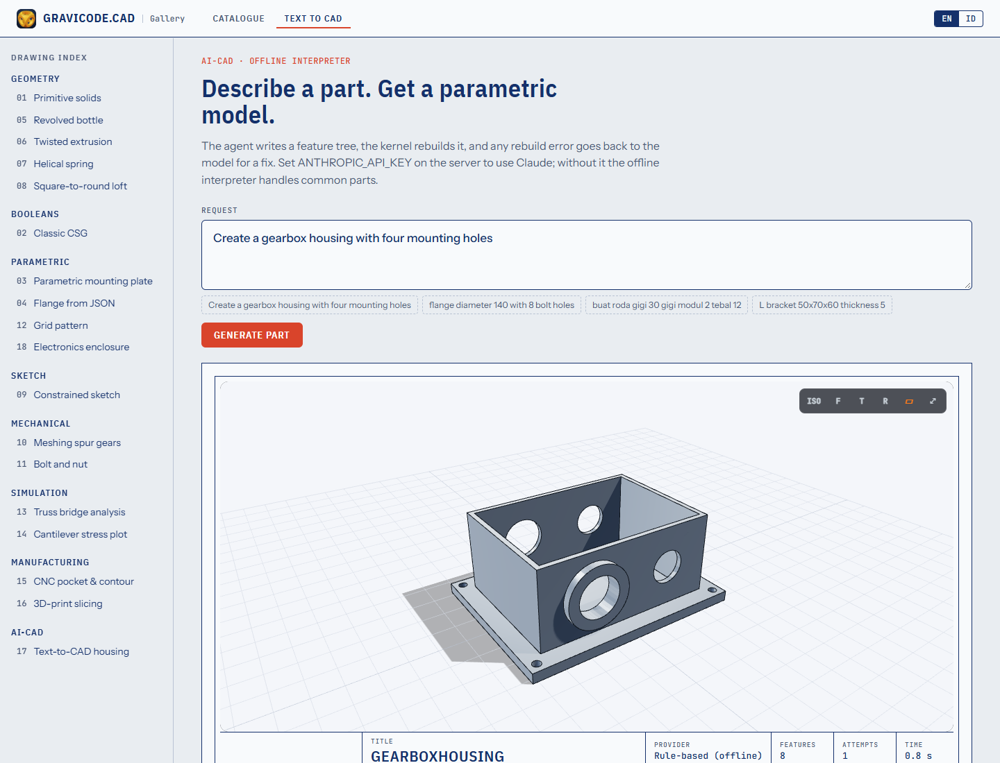

# AI-CAD: text to parametric parts

> 🇮🇩 [Baca dalam Bahasa Indonesia](../id/AI.md)

```text
"Create a gearbox housing with four mounting holes"
        │
        ▼
TextToCadAgent ──► language model writes a PartDefinition (JSON)
        │                ▲
        ▼                │ rebuild errors are sent back for repair (MaxRepairs = 2)
Parametric kernel rebuilds it
        │
        ▼
CadModel ──► .gcad.json · STEP · STL · GLB · PDF/SVG drawing · PNG
```

Because the model writes the same feature tree a human would, the output is **editable** (parameters stay), **checked** (it must rebuild into a solid with positive volume) and **exportable** to any format.

```csharp
using Gravicode.CAD.AI;

var agent = new TextToCadAgent(new ClaudeCadModel(apiKey));   // default model: claude-opus-5-5
var result = await agent.GenerateAsync("Create a gearbox housing with four mounting holes");

Console.WriteLine($"{result.Definition.Name}: {result.Attempts} attempt(s), {result.Elapsed.TotalSeconds:0.0}s");
result.ExportAll("out");          // MountingPlate.gcad.json, .step, .stl, .glb, .pdf, .svg
```

## Providers

| Provider | Class | Notes |
|---|---|---|
| Claude | `ClaudeCadModel(apiKey, model, workspaceId)` | official Anthropic .NET SDK, adaptive thinking, refusal fallbacks enabled by default (`server-side-fallback-2026-07-01`) |
| Azure OpenAI | `OpenAICompatibleCadModel.AzureOpenAI(endpoint, key, deployment)` | v1 chat-completions API |
| DeepSeek | `OpenAICompatibleCadModel.DeepSeek(key)` | |
| Hugging Face | `OpenAICompatibleCadModel.HuggingFace(token, model)` | router.huggingface.co |
| Any OpenAI-compatible server | `new OpenAICompatibleCadModel(http, baseUrl, key, model)` | Ollama, LM Studio, vLLM… |
| Offline | `new TextToCadAgent()` | `RuleBasedCadInterpreter`, English + Bahasa Indonesia |

`ProviderFactory.FromEnvironment()` picks the first configured of `ANTHROPIC_API_KEY` (+ optional `ANTHROPIC_WORKSPACE_ID`, `GRAVICODE_CLAUDE_MODEL`), `AZURE_OPENAI_API_KEY` + `AZURE_OPENAI_ENDPOINT` (+ `AZURE_OPENAI_DEPLOYMENT`), `DEEPSEEK_API_KEY`, `HF_TOKEN` (+ `HF_MODEL`). `ProviderFactory.FromKeyFile(path, "claude")` reads a local "Section / key: value" credentials file.

The system prompt (`CadPrompts.System`) documents the JSON schema and modelling conventions; the reply must contain one fenced JSON object followed by a short explanation, which becomes `result.Explanation`.

## Offline interpreter

Handles housings/enclosures/boxes, plates, L-brackets, flanges, spur gears, tubes/pipes, washers, hex nuts, stepped shafts, cylinders/standoffs and spheres, reading dimensions such as `150x90x10`, `diameter 40`, `tebal 5`, `modul 2`, hole counts (`four mounting holes`, `6 lubang`, `M8`).

```csharp
var def = RuleBasedCadInterpreter.Interpret("buat roda gigi 30 gigi modul 2 tebal 12");
```

## Testing with a real model

The test suite has an opt-in live test:

```bash
set GRAVICODE_LIVE_LLM=claude
set GRAVICODE_KEY_FILE=C:\path\to\keys.txt     # or ANTHROPIC_API_KEY
dotnet test --filter Live_llm_text_to_cad
```



---
Made by Gravicode Studios, led by Kang Fadhil.
