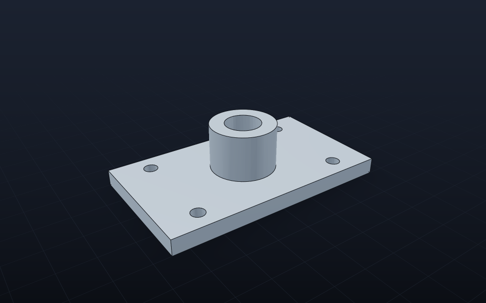

# Rendering

> 🇮🇩 [Baca dalam Bahasa Indonesia](../id/Rendering.md)

Gravicode.CAD can show a model in four ways. Pick by where your code runs.

| Package | Runs on | Use for |
|---|---|---|
| `Gravicode.CAD.Rendering` | anywhere | PNG thumbnails, CI screenshots, server previews, MAUI |
| `Gravicode.CAD.ThreeJs` | Blazor (browser) | interactive web viewer — see [ThreeJs](ThreeJs.md) |
| `Gravicode.CAD.ThreeNet` | desktop GPU | Avalonia / native windows — see [ThreeNet](ThreeNet.md) |
| `Gravicode.CAD.Viewer.Wpf` / `.WinForms` | Windows | drop-in viewport controls |

## Software renderer

Dependency-free and deterministic: deferred shading with a three-point light rig, hemispheric ambient, metallic/roughness speculars, filmic tone mapping, a soft ground shadow, a fading grid and depth-tested feature edges, supersampled and multi-threaded.

```csharp
var cam = new OrbitCamera { Yaw = -35, Pitch = 28 }.Fit(model.Bounds);
var img = SoftwareRenderer.Render(model, new RenderOptions
{
    Width = 1600, Height = 1000, Supersample = 2, Camera = cam,
    DrawEdges = true, GroundShadow = true, Grid = true,
});
img.SavePng("part.png");            // or img.EncodePng() → byte[]
```

`RenderOptions.Light` gives a white background; `TransparentBackground = true` produces cut-outs for compositing (the NuGet icon is made this way). `OrbitCamera.Orthographic = true` switches to parallel projection.

## WPF

```xml
<Window xmlns:gcad="clr-namespace:Gravicode.CAD.Viewer.Wpf;assembly=Gravicode.CAD.Viewer.Wpf">
    <gcad:CadViewport Model="{Binding Model}" />      <!-- or Source="engine.step" -->
</Window>
```

```csharp
Model = CadModel.Load("engine.step");
```

## WinForms

```csharp
var viewport = new CadViewport { Dock = DockStyle.Fill };
form.Controls.Add(viewport);
viewport.Load("engine.step");
```

Both controls orbit with the left button, pan with the right/middle button, zoom with the wheel and fit on double-click. They render a fast preview while dragging and a supersampled frame when you let go (`InteractiveView`).

## Engineering drawings

PDF and SVG exports of 3D models produce an A3 sheet with front, top, right and isometric views, hidden lines dashed, overall dimensions and a title block:

```csharp
model.ExportPdf("part.pdf", "Bracket");
var sheet = StandardDrawing.Create(model, "Bracket");   // entities you can edit or save as DXF
```



---
Made by Gravicode Studios, led by Kang Fadhil.
