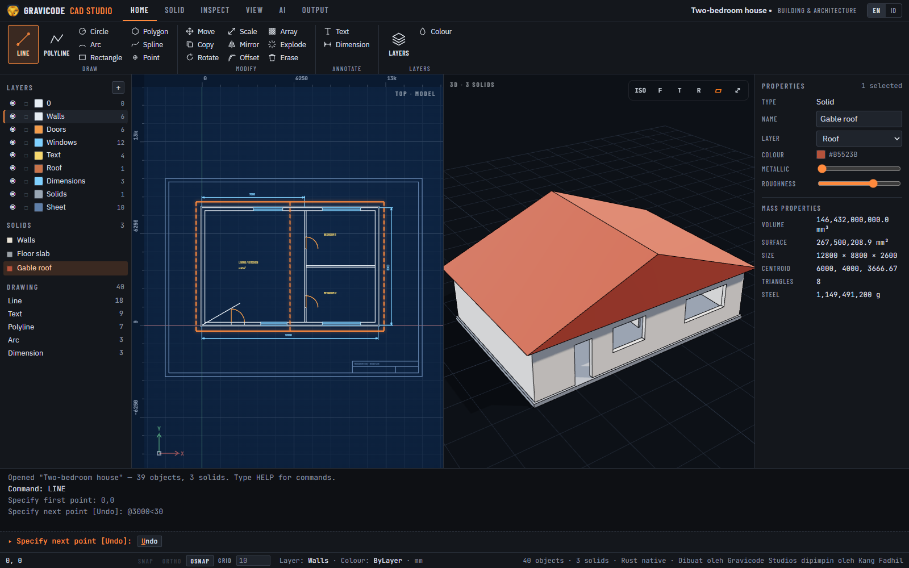
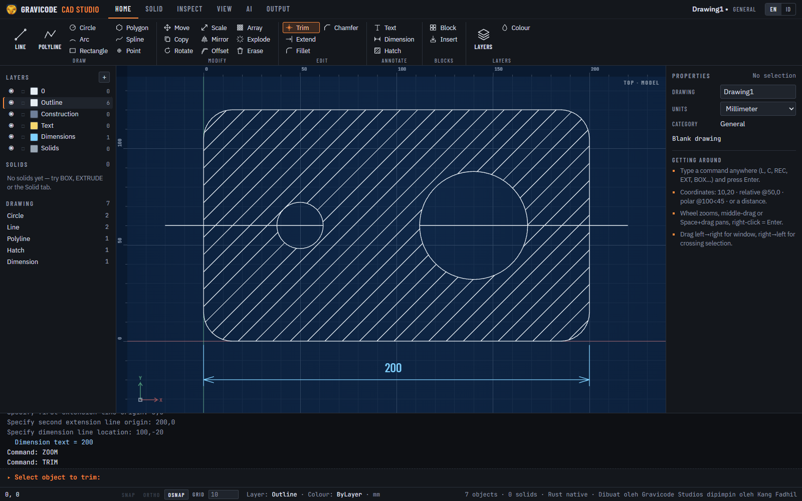
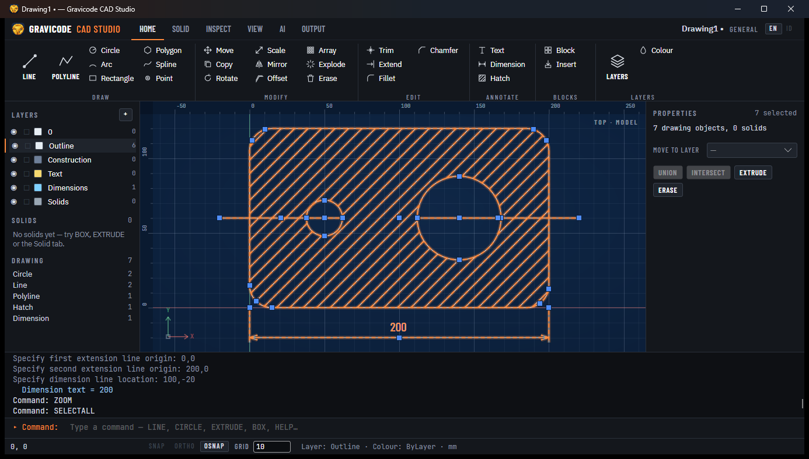
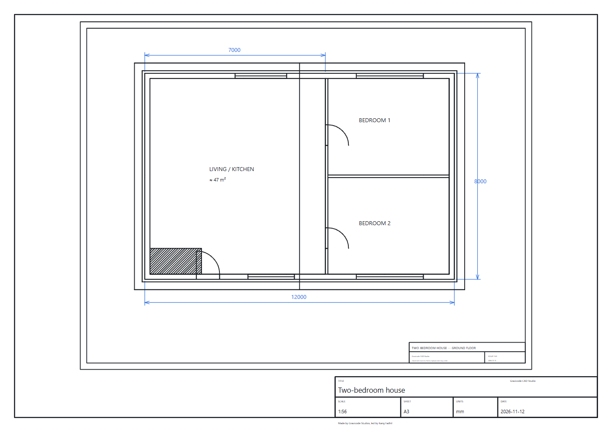
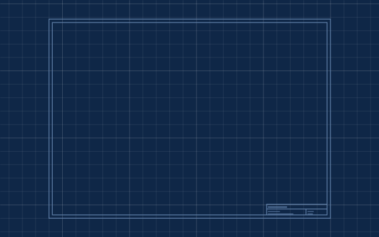
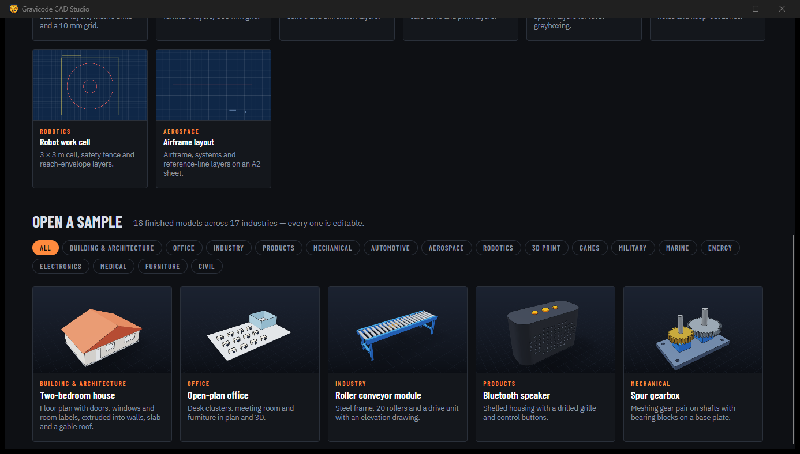
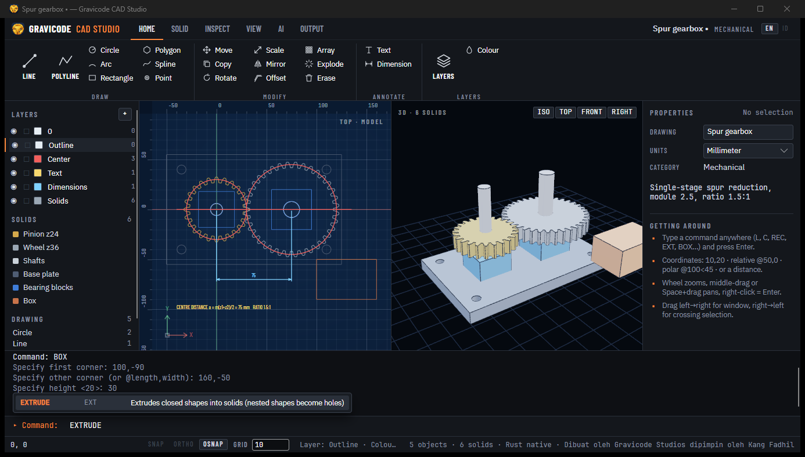
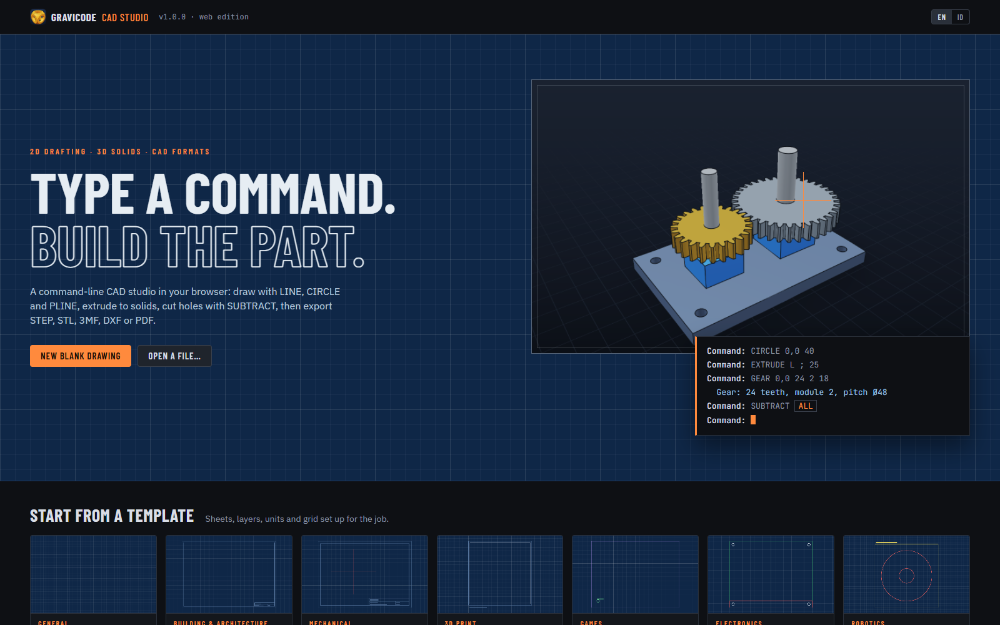

# Gravicode CAD Studio

A command-line driven CAD designer built on Gravicode.CAD, in two editions that share one engine:

| Edition | Stack | Run |
|---|---|---|
| **Web** | Blazor Server + `<CadViewer>` (three.js) | `dotnet run --project studio/Gravicode.CAD.Studio.Web` → http://localhost:5190 |
| **Desktop** | Avalonia 12 + ThreeNet (GPU) | `dotnet run --project studio/Gravicode.CAD.Studio.Desktop` |

Installers for Windows, Linux and macOS are attached to every
[GitHub release](https://github.com/DotNetVibeCoderz/Vibe_CAD/releases) tagged `gravicode-cad-studio-v*`.



## The screen

```text
┌ Ribbon: Home · Solid · Inspect · View · AI · Output ───────────────────────────┐
│ Layers / solids  │  2D model space (blueprint)  │  3D view  │  Properties      │
│                  │  rulers · grid · snaps        │  orbit    │  mass, colour…   │
├ Command history ──────────────────────────────────────────────────────────────┤
│ ▸ Command: _                                  keyword chips  [Undo] [Close]    │
├ Status: coordinates · SNAP ORTHO OSNAP · GRID · layer · units · kernel ────────┤
```

- **Model space** is blueprint paper: white linework, rulers, a grid that adapts to the zoom level, the UCS
  icon and a crosshair cursor. Whatever is selected glows safety orange.
- **Split view** shows the plan and the 3D model side by side (View → Plan / Split / 3D).
- **Start screen**: a blank drawing, 8 templates, 18 samples filtered by industry, or open any file.

## Working like AutoCAD

Start typing anywhere — keys go to the command line. Commands accept the usual input:

| Input | Meaning |
|---|---|
| `10,20` | absolute point |
| `@50,0` | relative to the last point |
| `@100<45` | polar: distance 100 at 45° |
| `75` | direct distance along the cursor direction (works with ORTHO) |
| Enter / right-click | finish the current step or command |
| Esc | cancel |
| `U` / `C` / keyword chips | command options, e.g. **U**ndo, **C**lose, **D**iameter |

Inline arguments and scripts run without prompts: `CIRCLE 0,0 40`, `EXTRUDE L ; 25`
(`;` = Enter, `L` = last object, `P` = previous selection, `ALL` = everything).

Selection: click, or drag **left→right** for a window (fully inside) and **right→left** for crossing.
Shift adds. Pick objects first and then run MOVE/COPY/EXTRUDE — the selection is used directly.

Aids: **F3** object snap (endpoint, midpoint, centre, quadrant, intersection), **F8** ortho, **F9** grid snap,
wheel zoom, middle-drag or Space+drag pan, double-middle-click zoom extents.

## Commands

| Group | Commands (aliases) |
|---|---|
| Draw | LINE (L), PLINE (PL), RECTANG (REC), CIRCLE (C), ARC (A), POLYGON (POL), SPLINE (SPL), POINT (PO), TEXT (T), HATCH (H) |
| Modify | MOVE (M), COPY (CO), ROTATE (RO), SCALE (SC), MIRROR (MI), OFFSET (O), ARRAY (AR, rectangular/polar), EXPLODE (X), ERASE (E), TRIM (TR), EXTEND (EX), FILLET (F), CHAMFER (CHA) |
| Annotate | DIMLINEAR (DLI) |
| Blocks | BLOCK (B), INSERT (I) |
| Output | PLOT (PRINT) |
| Solids | BOX, CYLINDER (CYL), CONE, SPHERE, TORUS (TOR), GEAR, EXTRUDE (EXT, nested shapes become holes), REVOLVE (REV), UNION (UNI), SUBTRACT (SU), INTERSECT (IN), ELEVATE (EL) |
| Inspect | DIST (DI), AREA (AA), MASSPROP (MP), LIST (LI) |
| Layers | LAYER (LA: New/Set/On/Off/Lock/Unlock/List), COLOR (COL) |
| View | ZOOM (Z), VIEW3D, PLAN, GRID, ORTHO, OSNAP, SELECTALL |
| AI | AI — describe a part; Claude generates it when `ANTHROPIC_API_KEY` is set (offline generator otherwise) |
| Utility | UNDO (Ctrl+Z), REDO (Ctrl+Y), HELP |

Booleans run on the Rust kernel when it is present (status bar shows the kernel).

## Drafting edits, grips, hatches and blocks



- **TRIM / EXTEND** work in quick mode: every visible object is a cutting edge or boundary. Pick the piece to
  remove (TRIM) or the end to lengthen (EXTEND); the canvas previews the result under the cursor. Trimming an
  object that nothing crosses erases it. Lines, arcs, circles and polylines (open or closed) are supported.
- **FILLET / CHAMFER** join two lines: `R` / `D` set the radius or the two distances (remembered between runs),
  radius 0 makes a sharp corner, and `P` (Polyline) rounds or bevels every corner of a polyline at once.
- **Grips**: select objects while no command runs and blue grips appear (up to 100 objects). Click a grip, move,
  click again to place it — line ends and midpoints, circle centres and quadrants, arc ends/middle/centre,
  polyline corners, dimension ends and dimension-line position. Esc cancels.
- **HATCH (H)**: click inside a closed area — the smallest closed shape around the point is the boundary and any
  closed shapes inside it become islands. `S` selects boundaries, `P` picks the pattern (ANSI31 45° lines,
  ANSI37 cross-hatch, SOLID fill), `Scale` and `Angle` adjust it. The default scale is automatic: about 40 lines
  across the area.
- **BLOCK (B)** turns selected objects into a named block (name → base point → objects); **INSERT (I)** places it
  with a scale and rotation. Redefining a block updates every reference; EXPLODE breaks a reference back into its
  objects. Blocks are saved in the `.gcproj`.



## Plotting

**PLOT** (Output tab, or type it) prints model space onto an ISO sheet:
paper A4–A0 → orientation → area (Extents or a Window) → scale (`Fit`, `1:50`, `2:1`, …) → title block →
PDF or SVG. One drawing unit becomes the given scale on paper (units are respected: a metre drawing at 1:100 is
plotted 10 mm per metre). The title block shows the drawing name, scale, sheet, units and date; dimensions use a
blue pen. The web edition downloads the file, the desktop edition asks where to save it.



## Files

- **Project**: `.gcproj` — gzip-compressed JSON with layers, drawing entities and solids.
- **Open / insert**: STEP, IGES, STL, OBJ, glTF/GLB, 3MF, DXF, SVG.
- **Export** (Output tab): STEP, STL, GLB, 3MF, DXF, SVG, PDF and a PNG render. Dimensions, hatches and blocks are
  exploded into lines, polylines and text on export so every format keeps them
  (a blueprint plot when the drawing has no solids).

## Templates and samples

| Templates | |
|---|---|
| Blank drawing (mm) · Architectural plan 1:50 · Mechanical part A3 · 3D print build plate · Game level blockout · Electronics enclosure · Robot work cell · Airframe layout |  |

Samples cover 17 industries: house (building & architecture), open-plan office, roller conveyor (industry),
Bluetooth speaker (products), spur gearbox and flange drawing (mechanical), wheel & brake (automotive),
sounding rocket (aerospace), 6-axis robot (robotics), phone stand plate (3D print), castle tower kit with
Blender-made props (games), rugged transport case (military), day-boat hull (marine), wind turbine (energy),
IoT enclosure (electronics), pill organiser (medical), dining set (furniture) and an FEM-analysed truss
footbridge (civil).



## Desktop edition



- GPU 3D through ThreeNet; `--software-3d` (or `GCAD_SOFTWARE_3D=1`) switches to the CPU renderer for remote
  desktops and VMs without a GPU, and it also kicks in automatically when the GPU fails.
- Double-clicking a `.gcproj` opens it (the installers register the file type).
- Closing with unsaved changes asks to save.

## Web edition



Each browser tab is its own session on the server. The release zips contain a self-contained server with
`start-studio.cmd` / `start-studio.sh`, which serves http://localhost:5190 and opens the browser.

## Code layout

| Project | Contents |
|---|---|
| `studio/Gravicode.CAD.Studio.Core` | document model with undo/redo, command engine, ~50 commands, `.gcproj` IO, catalog (templates + samples), ribbon definition, display lists |
| `studio/Gravicode.CAD.Studio.Web` | Blazor UI: ribbon, panels, `studioCanvas.js` blueprint canvas, command line |
| `studio/Gravicode.CAD.Studio.Desktop` | Avalonia UI: `BlueprintCanvas` control, ThreeNet 3D, file dialogs |
| `tests/Gravicode.CAD.Studio.Tests` | command scripts, booleans, undo, project round trip, exports, every catalog item |
| `studio/installer` | Inno Setup script, `.deb` and `.app`/`.dmg` packaging used by the release workflow |

Adding a command: register it in `StudioCommands` with `R("NAME", ["ALIAS"], "Group", "Description", Run)`;
`Run` is an iterator that `yield return`s prompts (`Prompt.Point`, `Prompt.Distance`, `Prompt.Select`, …) and
reads the answers from the context — both editions pick it up automatically.
