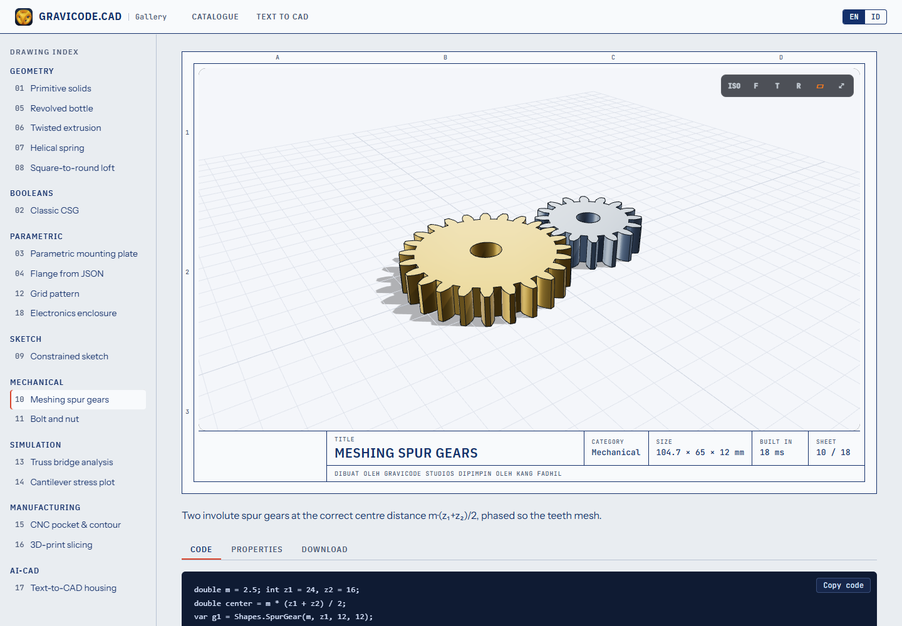

# Three.js viewer for Blazor

> 🇮🇩 [Baca dalam Bahasa Indonesia](../id/ThreeJs.md)

`Gravicode.CAD.ThreeJs` is a Razor class library with one component, `<CadViewer>`. Files are parsed by Gravicode.CAD in .NET (so **STEP works in the browser**), packed into one binary buffer and drawn by three.js.

```bash
dotnet add package Gravicode.CAD.ThreeJs
```

```razor
@using Gravicode.CAD.ThreeJs

<CadViewer Source="models/gear.step" Height="520px" />

<CadViewer Model="_model" Theme="light" AutoRotate="true" />
```

Interactive render mode is required (Server, WebAssembly or Auto). The component imports its module from `_content/Gravicode.CAD.ThreeJs/cadViewer.js`; three.js loads from jsDelivr (`three@0.170.0`). For offline deployments host `three.module.min.js` yourself and change the import at the top of `cadViewer.js`.

## Parameters

| Parameter | Default | Meaning |
|---|---|---|
| `Source` | — | URL (relative to the app base) of a STEP/STL/OBJ/glTF/3MF/DXF/IGES file |
| `Model` | — | a `CadModel` built in .NET (wins over `Source`) |
| `Height` | `480px` | CSS height |
| `Theme` | `dark` | `dark` or `light` |
| `ShowEdges`, `ShowGrid`, `ShowToolbar`, `AutoRotate` | `true, true, true, false` | |
| `OnLoaded` | — | callback with the loaded model |
| `KeepViewOnUpdate` | `false` | keep the camera when `Model` changes (editors) instead of framing every new model |
| `Selectable` | `false` | a click (no drag) raises `OnPick` with the body index (-1 = empty space), hit point, face normal and Shift/Ctrl |
| `Highlighted` | — | body indices drawn as selected (orange glow and edges) |
| `GizmoMode` | `null` | `"move"` (axis arrows), `"rotate"` (axis rings) or `"scale"` (uniform, square handles) on the highlighted bodies |
| `GizmoSnap` | `0` | move step in model units; rotations snap to 15°; Alt drags freely |
| `OnGizmo` | — | finished drag: `Mode`, `Delta` (move), `Axis` + `Angle` (rotate) or `Factor` (scale), about `Pivot`, CAD space |

Body indices count the model's visible, non-empty bodies in order. While a gizmo is dragged the selected bodies
move live in the browser; apply the edit in `OnGizmo` and pass the new model — it replaces the preview.

```razor
<CadViewer Model="_model" KeepViewOnUpdate="true" Selectable="true" Highlighted="_selected"
           GizmoMode="move" GizmoSnap="5" OnPick="e => Toggle(e.BodyIndex)" OnGizmo="Apply" />
```

Methods: `SetViewAsync("iso" | "front" | "top" | "right")`, `FitAsync()`, `ToggleEdgesAsync()`, `SnapshotAsync()` (PNG data URL), `RefreshAsync()` after mutating a model in place.

Controls: left-drag orbits, right/middle/shift-drag pans, wheel zooms, double-click fits.

## Live parameters

```razor
<input type="range" min="60" max="220" @bind="_od" @bind:event="oninput" @bind:after="Rebuild" />
<CadViewer Model="_model" />

@code {
    double _od = 140; CadModel? _model;
    protected override void OnInitialized() => Rebuild();
    void Rebuild() => _model = Part.Create("Flange").Cylinder(_od, 14).Holes(_od / 3, (0, 0)).Build();
}
```

Assigning a new `CadModel` instance re-renders automatically. Large models: raise `HubOptions.MaximumReceiveMessageSize` only if you send data from the browser; server-to-client payloads are not limited by it.



---
Made by Gravicode Studios, led by Kang Fadhil.
