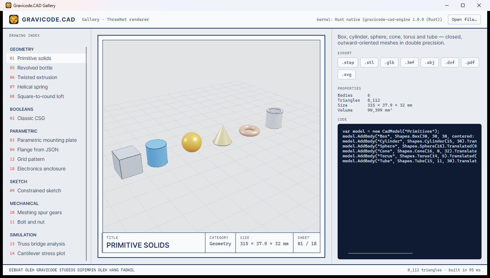

# ThreeNet (desktop GPU rendering)

> 🇮🇩 [Baca dalam Bahasa Indonesia](../id/ThreeNet.md)

[ThreeNet](https://github.com/DotNetVibeCoderz/Vibe_Graphics/tree/main/ThreeNet) is a Three.js-style scene graph for .NET with a Rust + wgpu core (DirectX 12, Metal, Vulkan). `Gravicode.CAD.ThreeNet` turns a `CadModel` into ThreeNet content.

```bash
dotnet add package Gravicode.CAD.ThreeNet
dotnet add package ThreeNet.Avalonia        # for the Avalonia control
```

## Avalonia

```csharp
using Gravicode.CAD.ThreeNet;
using ThreeNet.Avalonia;

var scene = new CadScene(light: true);          // studio lights, camera, grid
scene.SetModel(CadModel.Load("gearbox.step"));

var view = new ThreeNetView { Scene = scene.Scene, Camera = scene.Camera };
var orbit = new OrbitController(view, scene.Camera);
var (center, radius) = scene.Frame();
orbit.Target = center;
orbit.Distance = radius * 3.2f;
view.Frame += (_, _) => orbit.Apply();
```

`CadScene` does the CAD-specific work:

- **Z-up → Y-up**: CAD models live under a root node rotated −90° about X.
- **Crease-aware normals** (`ShadedMesh`, 35°) so planar faces are flat and cylinders smooth.
- **PBR materials** from each body's colour, metallic and roughness.
- **Feature edges** as line geometry (toggle with `ShowEdges`).
- **Grid** sized to the model.
- `ApplyCamera(OrbitCamera)` reuses cameras from the software renderer; `ToWorld(Vec3)` converts points.

## Standalone window

```csharp
using var cad = new CadScene();
cad.SetModel(model);
var window = new ThreeNet.AppWindow(ThreeNet.WindowOptions.Default with { Title = "Part" });
window.Render += (renderer, dt) => renderer.Render(cad.Scene, cad.Camera);
window.Run();
```

## No GPU?

If `ThreeNetView.RenderFailed` fires (remote desktop, VMs without a GPU adapter), fall back to `SoftwareRenderer` — the Avalonia gallery does exactly this.



---
Made by Gravicode Studios, led by Kang Fadhil.
