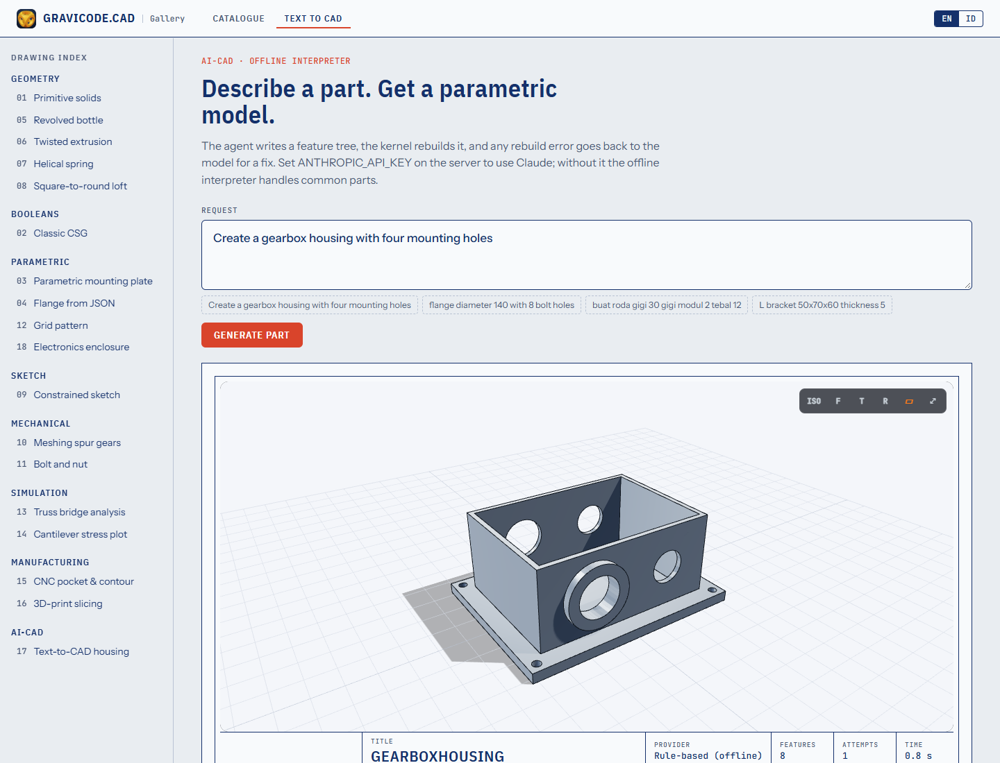

# AI-CAD: dari teks ke part parametrik

> 🇬🇧 [Read in English](../en/AI.md)

```text
"Buat housing gearbox dengan empat lubang mounting"
        │
        ▼
TextToCadAgent ──► model bahasa menulis PartDefinition (JSON)
        │                ▲
        ▼                │ error rebuild dikirim balik untuk diperbaiki (MaxRepairs = 2)
Kernel parametrik membangunnya
        │
        ▼
CadModel ──► .gcad.json · STEP · STL · GLB · gambar PDF/SVG · PNG
```

Karena model menulis feature tree yang sama seperti yang ditulis manusia, hasilnya **bisa diedit** (parameter tetap ada), **diperiksa** (harus menjadi solid dengan volume positif) dan **bisa diekspor** ke format apa pun.

```csharp
using Gravicode.CAD.AI;

var agen = new TextToCadAgent(new ClaudeCadModel(apiKey));   // model default: claude-opus-5-5
var hasil = await agen.GenerateAsync("Buat housing gearbox dengan empat lubang mounting");

Console.WriteLine($"{hasil.Definition.Name}: {hasil.Attempts} percobaan, {hasil.Elapsed.TotalSeconds:0.0} dtk");
hasil.ExportAll("out");          // .gcad.json, .step, .stl, .glb, .pdf, .svg
```

## Penyedia

| Penyedia | Kelas | Catatan |
|---|---|---|
| Claude | `ClaudeCadModel(apiKey, model, workspaceId)` | SDK .NET resmi Anthropic, adaptive thinking, fallback penolakan aktif default (`server-side-fallback-2026-07-01`) |
| Azure OpenAI | `OpenAICompatibleCadModel.AzureOpenAI(endpoint, key, deployment)` | API chat-completions v1 |
| DeepSeek | `OpenAICompatibleCadModel.DeepSeek(key)` | |
| Hugging Face | `OpenAICompatibleCadModel.HuggingFace(token, model)` | router.huggingface.co |
| Server OpenAI-compatible lain | `new OpenAICompatibleCadModel(http, baseUrl, key, model)` | Ollama, LM Studio, vLLM… |
| Offline | `new TextToCadAgent()` | `RuleBasedCadInterpreter`, Inggris + Bahasa Indonesia |

`ProviderFactory.FromEnvironment()` memilih yang pertama tersedia dari `ANTHROPIC_API_KEY` (+ opsional `ANTHROPIC_WORKSPACE_ID`, `GRAVICODE_CLAUDE_MODEL`), `AZURE_OPENAI_API_KEY` + `AZURE_OPENAI_ENDPOINT` (+ `AZURE_OPENAI_DEPLOYMENT`), `DEEPSEEK_API_KEY`, `HF_TOKEN` (+ `HF_MODEL`). `ProviderFactory.FromKeyFile(path, "claude")` membaca file kredensial lokal berformat "Bagian / kunci: nilai".

System prompt (`CadPrompts.System`) mendokumentasikan skema JSON dan konvensi pemodelan; balasan harus memuat satu objek JSON dalam blok kode diikuti penjelasan singkat, yang menjadi `hasil.Explanation`.

## Interpreter offline

Menangani housing/enclosure/kotak, pelat, braket L, flens, roda gigi lurus, pipa/tube, ring, mur hex, poros bertingkat, silinder/standoff dan bola, membaca dimensi seperti `150x90x10`, `diameter 40`, `tebal 5`, `modul 2`, serta jumlah lubang (`four mounting holes`, `6 lubang`, `M8`).

```csharp
var def = RuleBasedCadInterpreter.Interpret("buat roda gigi 30 gigi modul 2 tebal 12");
```

## Uji dengan model sungguhan

Test suite punya uji live yang harus diaktifkan:

```bash
set GRAVICODE_LIVE_LLM=claude
set GRAVICODE_KEY_FILE=C:\lokasi\keys.txt     # atau ANTHROPIC_API_KEY
dotnet test --filter Live_llm_text_to_cad
```



---
Dibuat oleh Gravicode Studios dipimpin oleh Kang Fadhil.
