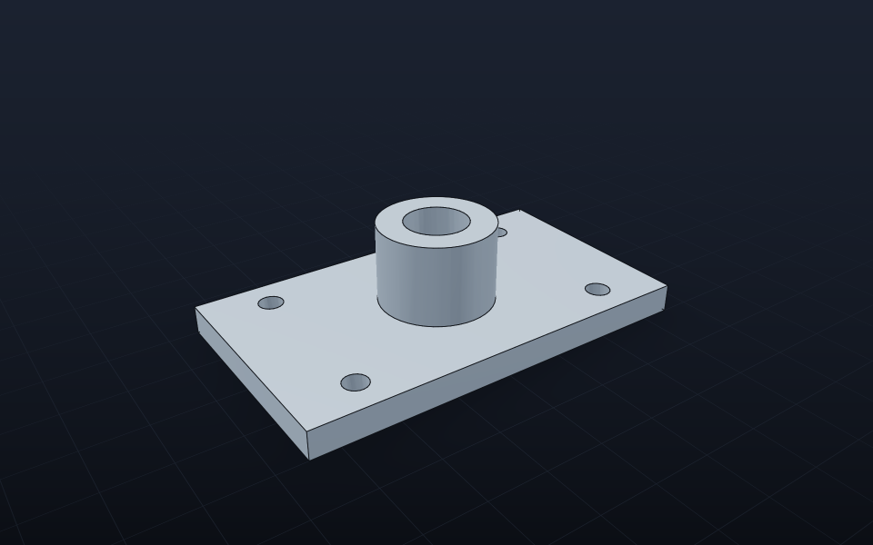

# Rendering

> 🇬🇧 [Read in English](../en/Rendering.md)

Gravicode.CAD bisa menampilkan model dengan empat cara. Pilih sesuai tempat kode Anda berjalan.

| Paket | Berjalan di | Untuk |
|---|---|---|
| `Gravicode.CAD.Rendering` | di mana saja | thumbnail PNG, screenshot CI, pratinjau server, MAUI |
| `Gravicode.CAD.ThreeJs` | Blazor (browser) | viewer web interaktif — lihat [ThreeJs](ThreeJs.md) |
| `Gravicode.CAD.ThreeNet` | GPU desktop | Avalonia / jendela native — lihat [ThreeNet](ThreeNet.md) |
| `Gravicode.CAD.Viewer.Wpf` / `.WinForms` | Windows | kontrol viewport siap pakai |

## Software renderer

Tanpa dependensi dan deterministik: deferred shading dengan tiga lampu, ambient hemisfer, specular metallic/roughness, tone mapping filmic, bayangan lantai yang lembut, grid memudar, dan feature edge yang diuji kedalaman — dengan supersampling dan multi-thread.

```csharp
var kamera = new OrbitCamera { Yaw = -35, Pitch = 28 }.Fit(model.Bounds);
var img = SoftwareRenderer.Render(model, new RenderOptions
{
    Width = 1600, Height = 1000, Supersample = 2, Camera = kamera,
    DrawEdges = true, GroundShadow = true, Grid = true,
});
img.SavePng("part.png");            // atau img.EncodePng() → byte[]
```

`RenderOptions.Light` memberi latar putih; `TransparentBackground = true` menghasilkan potongan transparan untuk komposisi (ikon NuGet dibuat dengan cara ini). `OrbitCamera.Orthographic = true` beralih ke proyeksi paralel.

## WPF

```xml
<Window xmlns:gcad="clr-namespace:Gravicode.CAD.Viewer.Wpf;assembly=Gravicode.CAD.Viewer.Wpf">
    <gcad:CadViewport Model="{Binding Model}" />      <!-- atau Source="engine.step" -->
</Window>
```

```csharp
Model = CadModel.Load("engine.step");
```

## WinForms

```csharp
var viewport = new CadViewport { Dock = DockStyle.Fill };
form.Controls.Add(viewport);
viewport.Load("engine.step");
```

Kedua kontrol: tombol kiri untuk orbit, tombol kanan/tengah untuk geser, roda untuk zoom, klik ganda untuk fit. Saat menyeret ditampilkan pratinjau cepat, dan frame supersampling saat dilepas (`InteractiveView`).

## Gambar teknik

Ekspor PDF dan SVG dari model 3D menghasilkan lembar A3 dengan tampak depan, atas, kanan dan isometrik, garis tersembunyi putus-putus, dimensi keseluruhan dan title block:

```csharp
model.ExportPdf("part.pdf", "Braket");
var lembar = StandardDrawing.Create(model, "Braket");   // entitas yang bisa diedit atau disimpan sebagai DXF
```



---
Dibuat oleh Gravicode Studios dipimpin oleh Kang Fadhil.
