# Gravicode CAD Studio

Aplikasi desain CAD berbasis baris perintah yang dibangun di atas Gravicode.CAD, tersedia dalam dua edisi
yang memakai satu engine yang sama:

| Edisi | Teknologi | Menjalankan |
|---|---|---|
| **Web** | Blazor Server + `<CadViewer>` (three.js) | `dotnet run --project studio/Gravicode.CAD.Studio.Web` → http://localhost:5190 |
| **Desktop** | Avalonia 12 + ThreeNet (GPU) | `dotnet run --project studio/Gravicode.CAD.Studio.Desktop` |

Installer untuk Windows, Linux dan macOS dilampirkan di setiap
[rilis GitHub](https://github.com/DotNetVibeCoderz/Vibe_CAD/releases) dengan tag `gravicode-cad-studio-v*`.

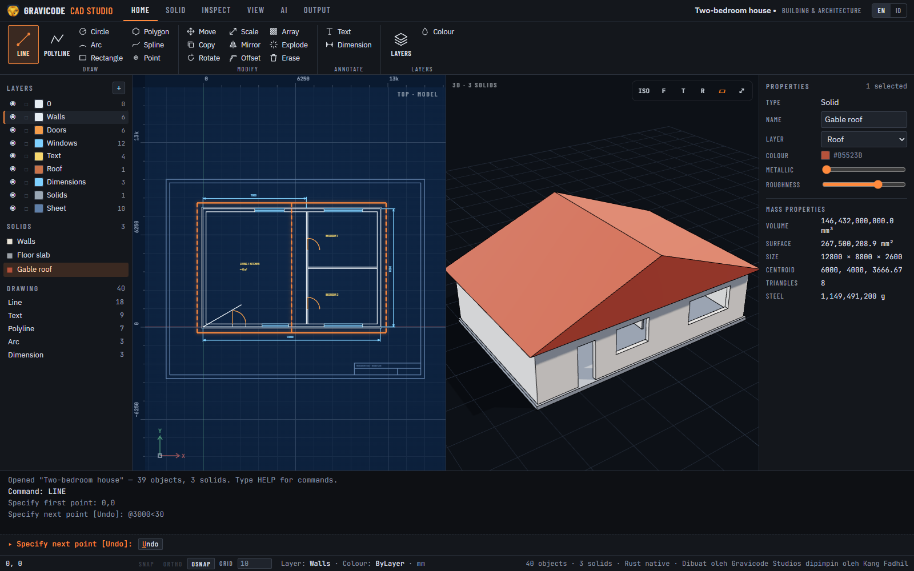

## Tampilan

```text
┌ Ribbon: Beranda · Solid · Periksa · Tampilan · AI · Output ────────────────────┐
│ Layer / solid    │  Ruang model 2D (blueprint)   │  Tampilan │  Properti        │
│                  │  penggaris · grid · snap      │  3D       │  massa, warna…   │
├ Riwayat perintah ─────────────────────────────────────────────────────────────┤
│ ▸ Command: _                                  chip kata kunci [Undo] [Close]   │
├ Status: koordinat · SNAP ORTHO OSNAP · GRID · layer · satuan · kernel ─────────┤
```

- **Ruang model** berupa kertas blueprint: garis putih, penggaris, grid yang menyesuaikan zoom, ikon UCS dan
  kursor crosshair. Objek terpilih menyala oranye.
- **Tampilan split** menampilkan denah dan model 3D berdampingan (Tampilan → Plan / Split / 3D).
- **Layar awal**: gambar kosong, 8 template, 18 contoh dengan filter industri, atau buka file apa pun.
- Bahasa antarmuka bisa diganti EN / ID kapan saja.

## Bekerja seperti AutoCAD

Ketik di mana saja — tombol langsung masuk ke baris perintah. Format masukan:

| Masukan | Arti |
|---|---|
| `10,20` | titik absolut |
| `@50,0` | relatif terhadap titik terakhir |
| `@100<45` | polar: jarak 100 pada sudut 45° |
| `75` | jarak langsung searah kursor (bekerja dengan ORTHO) |
| Enter / klik kanan | selesaikan langkah atau perintah |
| Esc | batal |
| `U` / `C` / chip kata kunci | opsi perintah, mis. **U**ndo, **C**lose, **D**iameter |

Argumen langsung dan skrip berjalan tanpa prompt: `CIRCLE 0,0 40`, `EXTRUDE L ; 25`
(`;` = Enter, `L` = objek terakhir, `P` = seleksi sebelumnya, `ALL` = semua).

Seleksi: klik, atau seret **kiri→kanan** untuk window (harus di dalam) dan **kanan→kiri** untuk crossing.
Shift menambah. Pilih objek dulu lalu jalankan MOVE/COPY/EXTRUDE — seleksi langsung dipakai.

Bantuan: **F3** object snap (endpoint, midpoint, center, quadrant, intersection), **F8** ortho,
**F9** grid snap, roda mouse untuk zoom, seret tombol tengah atau Spasi+seret untuk geser.

## Perintah

| Kelompok | Perintah (alias) |
|---|---|
| Gambar | LINE (L), PLINE (PL), RECTANG (REC), CIRCLE (C), ARC (A), POLYGON (POL), SPLINE (SPL), POINT (PO), TEXT (T), HATCH (H) |
| Ubah | MOVE (M), COPY (CO), ROTATE (RO), SCALE (SC), MIRROR (MI), OFFSET (O), ARRAY (AR, persegi/polar), EXPLODE (X), ERASE (E), TRIM (TR), EXTEND (EX), FILLET (F), CHAMFER (CHA) |
| Anotasi | DIMLINEAR (DLI) |
| Block | BLOCK (B), INSERT (I) |
| Keluaran | PLOT (PRINT) |
| Solid | BOX, CYLINDER (CYL), CONE, SPHERE, TORUS (TOR), GEAR, EXTRUDE (EXT, bentuk bersarang jadi lubang), REVOLVE (REV), UNION (UNI), SUBTRACT (SU), INTERSECT (IN), ELEVATE (EL), 3DMOVE (3M), 3DROTATE (3R), 3DSCALE (3S), PARAM (histori) |
| Ruang | UCS (Face / World / List), MODEL (MS), LAYOUT (LO: New / Set / List / Delete), MVIEW (MV) |
| Periksa | DIST (DI), AREA (AA), MASSPROP (MP), LIST (LI) |
| Layer | LAYER (LA: New/Set/On/Off/Lock/Unlock/List), COLOR (COL) |
| Tampilan | ZOOM (Z), VIEW3D, PLAN, GRID, ORTHO, OSNAP, SELECTALL |
| AI | AI — deskripsikan komponen; Claude membuatnya bila `ANTHROPIC_API_KEY` diset (selain itu generator offline) |
| Utilitas | UNDO (Ctrl+Z), REDO (Ctrl+Y), HELP |

Operasi boolean memakai kernel Rust bila tersedia (lihat status bar).

## Edit drafting, grip, hatch dan block

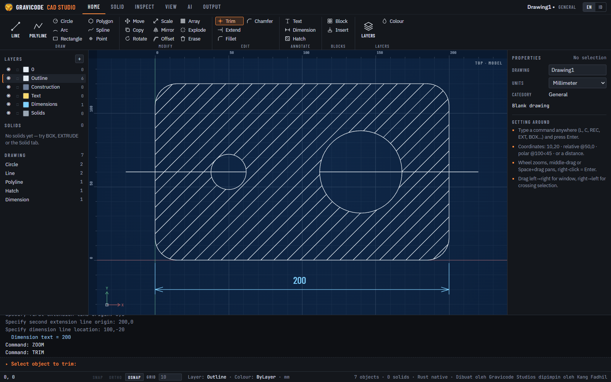

- **TRIM / EXTEND** bekerja dalam mode cepat: semua objek yang terlihat menjadi tepi pemotong atau batas. Pilih
  bagian yang dibuang (TRIM) atau ujung yang diperpanjang (EXTEND); kanvas menampilkan pratinjau di bawah kursor.
  Objek yang tidak dipotong apa pun akan terhapus. Mendukung garis, busur, lingkaran dan polyline (terbuka/tertutup).
- **FILLET / CHAMFER** menyambung dua garis: `R` / `D` mengatur radius atau dua jarak (diingat antar-perintah),
  radius 0 membuat sudut tajam, dan `P` (Polyline) membulatkan atau memotong semua sudut polyline sekaligus.
  Fillet polyline berupa **segmen busur sejati** (bulge, seperti LWPOLYLINE DXF): bisa di-snap ke tengah dan pusatnya,
  tetap busur di DXF, dan EXPLODE memecahnya menjadi garis dan busur.
- **Grip**: pilih objek saat tidak ada perintah berjalan dan grip biru muncul (hingga 100 objek). Klik grip, gerakkan,
  klik lagi untuk meletakkan — ujung dan tengah garis, pusat dan kuadran lingkaran, ujung/tengah/pusat busur,
  sudut polyline, ujung dimensi dan posisi garis dimensi. Esc membatalkan.
- **HATCH (H)**: klik di dalam area tertutup — bentuk tertutup terkecil di sekitar titik menjadi batas, dan bentuk
  tertutup di dalamnya menjadi pulau (island). `S` memilih batas, `P` memilih pola (ANSI31 garis 45°, ANSI37
  arsiran silang, SOLID isian penuh), `Scale` dan `Angle` mengaturnya. Skala bawaan otomatis: sekitar 40 garis
  melintang area.
- **BLOCK (B)** mengubah objek terpilih menjadi block bernama (nama → titik dasar → objek); **INSERT (I)**
  menempatkannya dengan skala dan rotasi. Mendefinisikan ulang block memperbarui semua referensinya; EXPLODE
  memecah referensi kembali menjadi objek. Block ikut tersimpan di `.gcproj`.

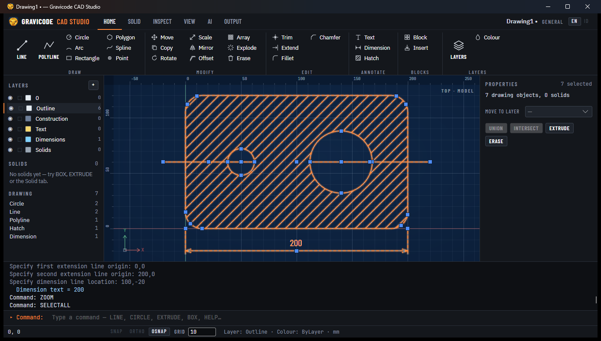

## Seleksi 3D dan gizmo

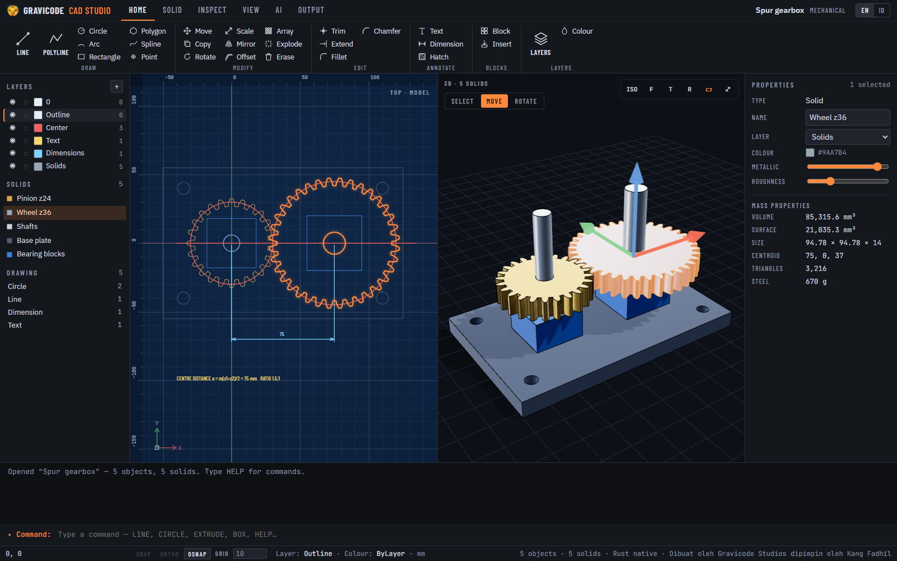

Di panel 3D, **klik** memilih solid di bawah kursor (Shift/Ctrl menambah atau mengurangi, klik ruang kosong
mengosongkan); seret tetap untuk orbit kamera. Solid terpilih menyala oranye di 3D dan di denah, dan seleksinya sama
dengan tampilan 2D serta semua perintah (`SUBTRACT`, `MASSPROP`, …).

Bilah di kiri atas panel 3D mengganti gizmo:

- **PINDAH**: seret panah merah/hijau/biru untuk memindah seleksi sepanjang X, Y atau Z. Langkahnya mengikuti ukuran
  grid (status bar `GRID`); tahan **Alt** untuk gerakan bebas.
- **PUTAR**: seret cincin untuk memutar seleksi pada sumbu itu melalui pusatnya, per 15° (Alt = bebas).
- **SKALA**: seret pegangan kotak ke luar untuk menskala seragam terhadap pusat, per 0,1 (Alt = bebas).
- **PILIH**: tanpa gizmo, hanya memilih.

Setiap seretan adalah satu langkah undo. Dari keyboard: `3DMOVE` (perpindahan `dx,dy,dz`), `3DROTATE` (sumbu
X/Y/Z, sudut) dan `3DSCALE` (faktor). Edisi desktop menggambar gizmo yang sama di atas tampilan GPU:

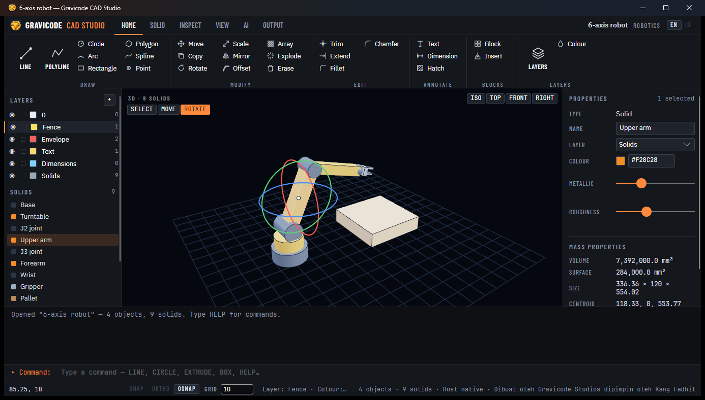

## Menggambar di permukaan

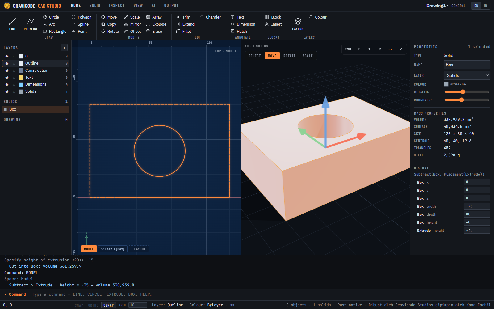

**Sketch on face** (tab Tampilan) atau `UCS Face`, lalu klik permukaan di tampilan 3D: tampilan 2D berpindah ke
permukaan itu — garis tepinya terlihat (dan bisa di-snap), titik asal di sudut kiri bawah permukaan dan sumbu Y
mengarah ke atas pada dinding. Gambar bentuk tertutup lalu `EXTRUDE`: **tinggi positif menambah material** pada
solid itu, **tinggi negatif memotong** kantong atau lubang. Sketsa di permukaan juga tampil di 3D. Bilah di bawah
tampilan 2D berpindah antara **MODEL**, setiap permukaan (◇) dan setiap layout (▭); `MODEL` atau `UCS World` kembali
ke denah.

## Histori parametrik

Solid yang dibuat dengan perintah mengingat cara pembuatannya — pohon fitur seperti
`Subtract(Box, Placement(Extrude))`. Pilih solid dan **Histori** tampil di panel properti dengan semua angkanya
(ukuran box, radius silinder, tinggi extrude, jumlah gigi, …). Ubah satu angka dan seluruh solid dibangun ulang,
termasuk boolean dan perpindahan; setiap perubahan satu langkah undo. `PARAM` melakukan hal yang sama dari baris
perintah. Geser, putar, skala dan mirror disimpan sebagai penempatan; solid impor, AI dan contoh tidak punya histori.

## Layout ruang kertas

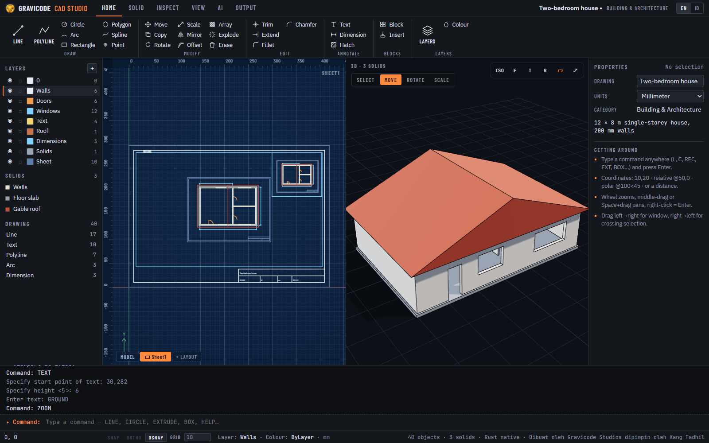

`LAYOUT New` (atau **+ LAYOUT**) membuat lembar (A4–A0, orientasi) dengan border, title block dan satu viewport
yang menampilkan model pada skala standar terbesar yang muat (1:1, 1:2, 1:2,5, 1:5 × 10ⁿ). `MVIEW` menambah viewport:
dua sudut di kertas, skala (`1:200`) dan titik model di tengahnya. Apa pun yang digambar saat layout aktif — catatan,
label, dimensi tambahan — dalam milimeter kertas dan milik lembar itu. `PLOT` di layout mencetaknya 1:1 pada
kertasnya sebagai PDF atau SVG (beberapa skala tercetak "AS SHOWN" di title block).

## Plotting

**PLOT** (tab Output, atau ketik) mencetak ruang model ke lembar ISO:
kertas A4–A0 → orientasi → area (Extents atau Window) → skala (`Fit`, `1:50`, `2:1`, …) → title block →
PDF atau SVG. Satuan gambar dihormati (gambar dalam meter pada 1:100 dicetak 10 mm per meter). Title block berisi
nama gambar, skala, lembar, satuan dan tanggal; dimensi memakai pena biru. Edisi web mengunduh file, edisi desktop
menanyakan lokasi penyimpanan.

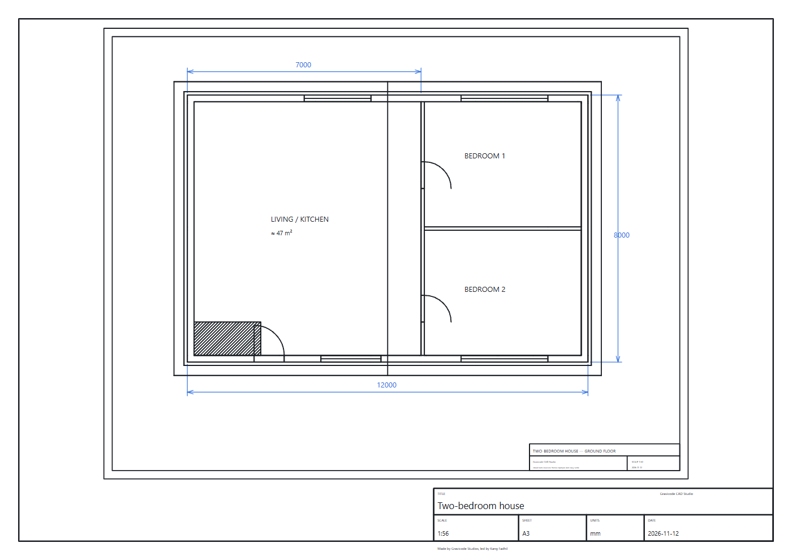

## File

- **Proyek**: `.gcproj` — JSON terkompresi gzip berisi layer, entitas gambar dan solid.
- **Buka / sisipkan**: STEP, IGES, STL, OBJ, glTF/GLB, 3MF, DXF, SVG.
- **Ekspor** (tab Output): STEP, STL, GLB, 3MF, DXF, SVG, PDF dan render PNG. Dimensi, hatch dan block dipecah
  menjadi garis, polyline dan teks saat ekspor sehingga tetap ada di semua format
  (plot blueprint bila gambar tidak punya solid).

## Template dan contoh

Template: gambar kosong (mm), denah arsitektur 1:50, komponen mekanik A3, build plate 3D print, blockout level
game, enclosure elektronik, sel kerja robot, layout airframe.

Contoh mencakup 17 industri: rumah (bangunan & arsitektur), kantor open-plan, conveyor roller (industri),
speaker Bluetooth (produk), gearbox roda gigi dan gambar flens (mekanik), roda & rem (otomotif), roket
(dirgantara), robot 6-sumbu (robotika), dudukan HP (3D print), menara kastil dengan properti buatan Blender
(game), koper peralatan militer, lambung kapal (maritim), turbin angin (energi), enclosure IoT (elektronik),
kotak obat mingguan (medis), set meja makan (furnitur) dan jembatan rangka yang dianalisis FEM (sipil).

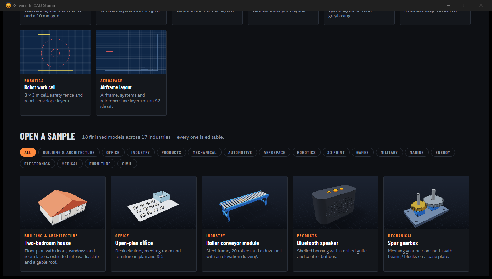

## Pembaruan dan installer bertanda tangan

Edisi desktop memeriksa rilis baru di GitHub beberapa detik setelah dibuka (dan dari **Output → Updates**): tombol
**PERBARUI x.y.z** muncul di status bar dan membuka halaman unduhan. Permintaannya anonim dan bisa dimatikan dengan
`GCAD_NO_UPDATE_CHECK=1`.

Workflow rilis menandatangani installer bila repositori punya secret: `WINDOWS_CERT_PFX` + `WINDOWS_CERT_PASSWORD`
(Authenticode, signtool) dan `MACOS_CERT_P12` + `MACOS_CERT_PASSWORD` + `MACOS_SIGN_IDENTITY` (Developer ID dengan
hardened runtime), serta `APPLE_ID` + `APPLE_TEAM_ID` + `APPLE_APP_PASSWORD` untuk notarisasi. Tanpa secret itu
build tidak bertanda tangan tetapi selebihnya sama.

## Edisi desktop

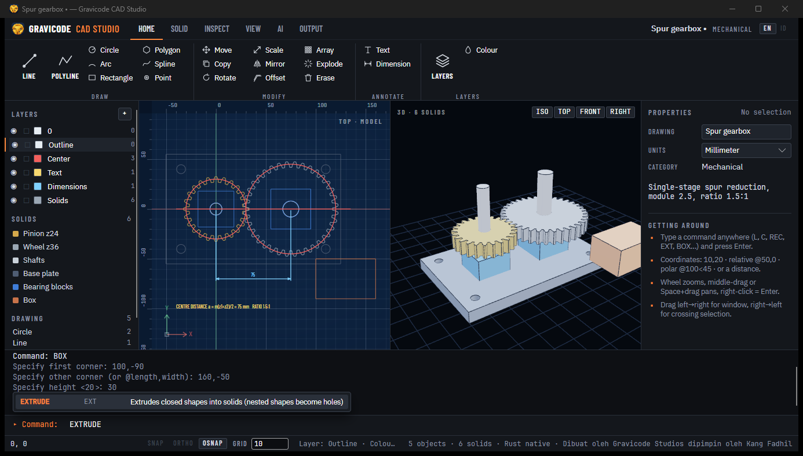

- 3D di GPU lewat ThreeNet; `--software-3d` (atau `GCAD_SOFTWARE_3D=1`) memakai renderer CPU untuk remote
  desktop / VM tanpa GPU, dan otomatis dipakai bila GPU gagal.
- Klik dua kali file `.gcproj` untuk membukanya (installer mendaftarkan tipe file).
- Menutup aplikasi dengan perubahan yang belum disimpan akan menanyakan penyimpanan.

## Edisi web

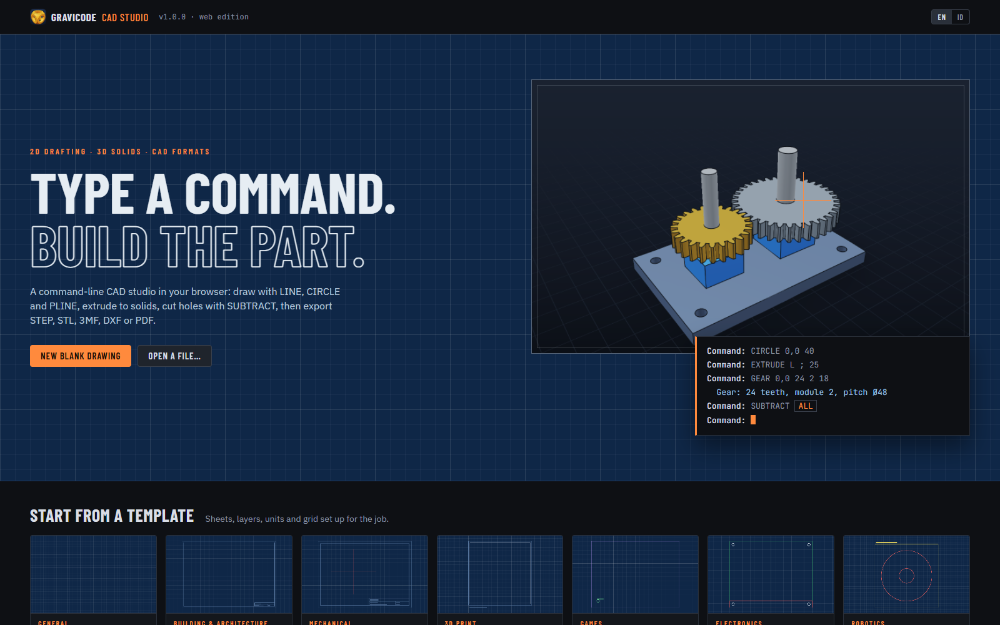

Setiap tab browser adalah sesi tersendiri di server. Zip rilis berisi server self-contained dengan
`start-studio.cmd` / `start-studio.sh` yang menjalankan http://localhost:5190 dan membuka browser.

## Struktur kode

| Proyek | Isi |
|---|---|
| `studio/Gravicode.CAD.Studio.Core` | model dokumen dengan undo/redo, command engine, ~50 perintah, IO `.gcproj`, katalog (template + contoh), definisi ribbon, display list |
| `studio/Gravicode.CAD.Studio.Web` | UI Blazor: ribbon, panel, kanvas blueprint `studioCanvas.js`, baris perintah |
| `studio/Gravicode.CAD.Studio.Desktop` | UI Avalonia: kontrol `BlueprintCanvas`, 3D ThreeNet, dialog file |
| `tests/Gravicode.CAD.Studio.Tests` | skrip perintah, boolean, undo, round trip proyek, ekspor, semua item katalog |
| `studio/installer` | skrip Inno Setup, paket `.deb` dan `.app`/`.dmg` untuk workflow rilis |

Menambah perintah: daftarkan di `StudioCommands` dengan `R("NAMA", ["ALIAS"], "Grup", "Deskripsi", Run)`;
`Run` adalah iterator yang melakukan `yield return` prompt (`Prompt.Point`, `Prompt.Distance`,
`Prompt.Select`, …) dan membaca jawabannya dari context — kedua edisi otomatis mendapatkannya.
