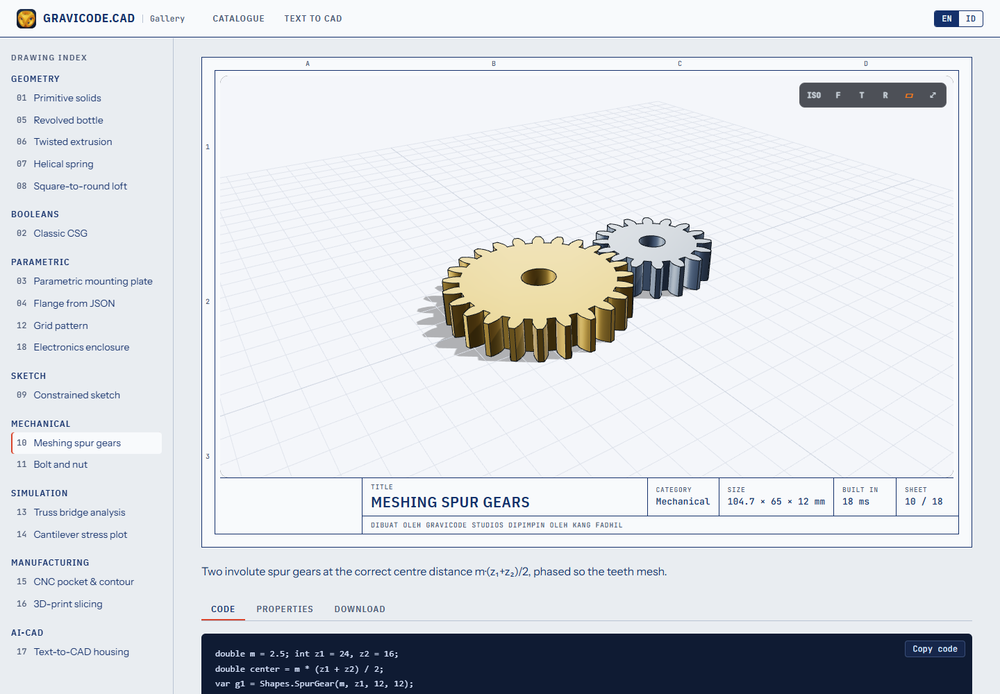

# Viewer Three.js untuk Blazor

> 🇬🇧 [Read in English](../en/ThreeJs.md)

`Gravicode.CAD.ThreeJs` adalah Razor class library dengan satu komponen, `<CadViewer>`. File diurai oleh Gravicode.CAD di .NET (sehingga **STEP bisa tampil di browser**), dikemas menjadi satu buffer biner, lalu digambar oleh three.js.

```bash
dotnet add package Gravicode.CAD.ThreeJs
```

```razor
@using Gravicode.CAD.ThreeJs

<CadViewer Source="models/gear.step" Height="520px" />

<CadViewer Model="_model" Theme="light" AutoRotate="true" />
```

Membutuhkan render mode interaktif (Server, WebAssembly atau Auto). Komponen mengimpor modul dari `_content/Gravicode.CAD.ThreeJs/cadViewer.js`; three.js dimuat dari jsDelivr (`three@0.170.0`). Untuk deployment offline, host `three.module.min.js` sendiri lalu ganti import di baris atas `cadViewer.js`.

## Parameter

| Parameter | Default | Arti |
|---|---|---|
| `Source` | — | URL (relatif terhadap base aplikasi) file STEP/STL/OBJ/glTF/3MF/DXF/IGES |
| `Model` | — | `CadModel` yang dibangun di .NET (mengalahkan `Source`) |
| `Height` | `480px` | tinggi CSS |
| `Theme` | `dark` | `dark` atau `light` |
| `ShowEdges`, `ShowGrid`, `ShowToolbar`, `AutoRotate` | `true, true, true, false` | |
| `OnLoaded` | — | callback berisi model yang dimuat |

Method: `SetViewAsync("iso" | "front" | "top" | "right")`, `FitAsync()`, `ToggleEdgesAsync()`, `SnapshotAsync()` (data URL PNG), `RefreshAsync()` setelah mengubah model di tempat.

Kontrol: seret kiri untuk orbit, seret kanan/tengah/shift untuk geser, roda untuk zoom, klik ganda untuk fit.

## Parameter langsung

```razor
<input type="range" min="60" max="220" @bind="_od" @bind:event="oninput" @bind:after="Rebuild" />
<CadViewer Model="_model" />

@code {
    double _od = 140; CadModel? _model;
    protected override void OnInitialized() => Rebuild();
    void Rebuild() => _model = Part.Create("Flens").Cylinder(_od, 14).Holes(_od / 3, (0, 0)).Build();
}
```

Memberi instance `CadModel` baru otomatis merender ulang. Untuk model besar, `HubOptions.MaximumReceiveMessageSize` hanya perlu dinaikkan bila data dikirim dari browser; payload server-ke-klien tidak dibatasinya.



---
Dibuat oleh Gravicode Studios dipimpin oleh Kang Fadhil.
