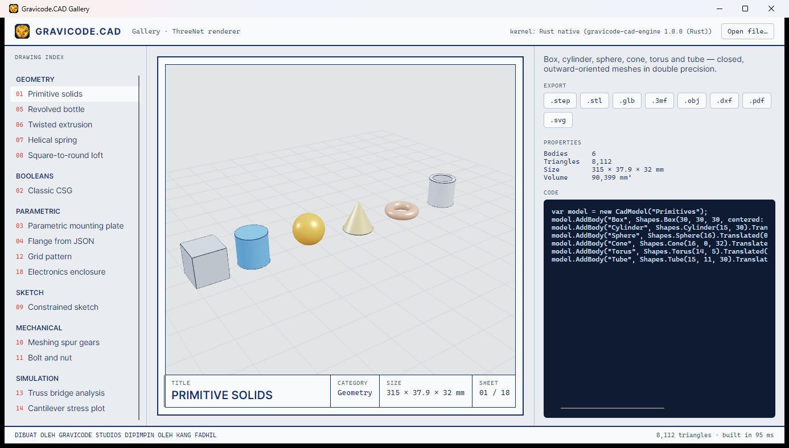

# ThreeNet (rendering GPU desktop)

> 🇬🇧 [Read in English](../en/ThreeNet.md)

[ThreeNet](https://github.com/DotNetVibeCoderz/Vibe_Graphics/tree/main/ThreeNet) adalah scene graph bergaya Three.js untuk .NET dengan inti Rust + wgpu (DirectX 12, Metal, Vulkan). `Gravicode.CAD.ThreeNet` mengubah `CadModel` menjadi konten ThreeNet.

```bash
dotnet add package Gravicode.CAD.ThreeNet
dotnet add package ThreeNet.Avalonia        # untuk kontrol Avalonia
```

## Avalonia

```csharp
using Gravicode.CAD.ThreeNet;
using ThreeNet.Avalonia;

var scene = new CadScene(light: true);          // lampu studio, kamera, grid
scene.SetModel(CadModel.Load("gearbox.step"));

var view = new ThreeNetView { Scene = scene.Scene, Camera = scene.Camera };
var orbit = new OrbitController(view, scene.Camera);
var (pusat, radius) = scene.Frame();
orbit.Target = pusat;
orbit.Distance = radius * 3.2f;
view.Frame += (_, _) => orbit.Apply();
```

`CadScene` menangani hal khusus CAD:

- **Z-up → Y-up**: model CAD diletakkan di bawah node akar yang diputar −90° terhadap X.
- **Normal sadar-lipatan** (`ShadedMesh`, 35°) sehingga muka planar datar dan silinder halus.
- **Material PBR** dari warna, metallic dan roughness tiap body.
- **Feature edge** sebagai geometri garis (atur dengan `ShowEdges`).
- **Grid** menyesuaikan ukuran model.
- `ApplyCamera(OrbitCamera)` memakai kamera dari software renderer; `ToWorld(Vec3)` mengonversi titik.

## Jendela mandiri

```csharp
using var cad = new CadScene();
cad.SetModel(model);
var window = new ThreeNet.AppWindow(ThreeNet.WindowOptions.Default with { Title = "Part" });
window.Render += (renderer, dt) => renderer.Render(cad.Scene, cad.Camera);
window.Run();
```

## Tidak ada GPU?

Bila `ThreeNetView.RenderFailed` terpicu (remote desktop, VM tanpa adapter GPU), gunakan `SoftwareRenderer` sebagai cadangan — galeri Avalonia melakukan persis hal ini.



---
Dibuat oleh Gravicode Studios dipimpin oleh Kang Fadhil.
